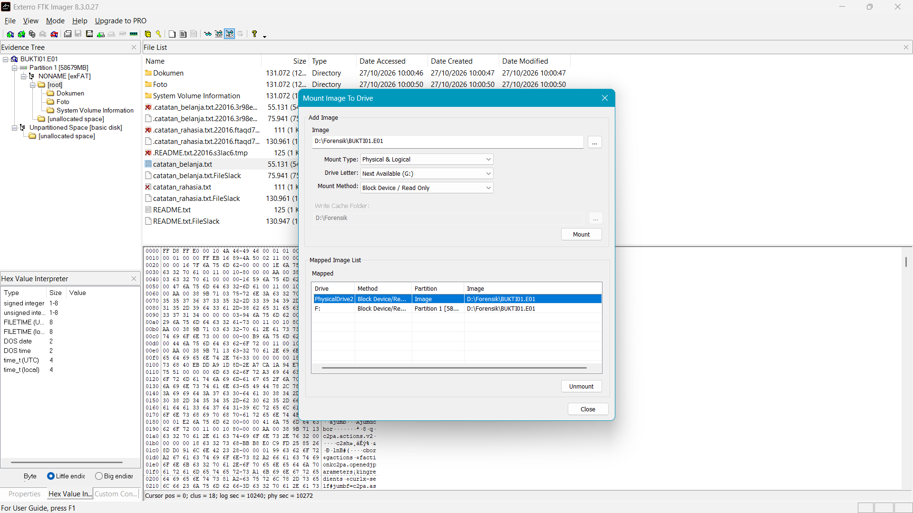
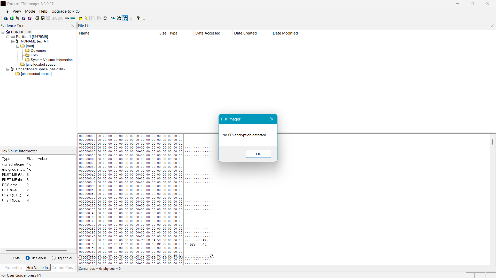

# Panduan Lengkap (Satu Halaman)

Dokumen ini menggabungkan panduan langkah 01–12 dalam satu halaman, dari mengunduh FTK Imager sampai laporan siap dikumpulkan. Isinya sama dengan file terpisah di folder [`panduan/`](panduan). Masalah lain ada di [troubleshooting.md](troubleshooting.md), dan variasi studi kasus ada di [skenario/](skenario/README.md).

## Daftar Langkah

- [01 – Alat dan Bahan](#01--alat-dan-bahan)
- [02 – Mengunduh dan Menginstal FTK Imager](#02--mengunduh-dan-menginstal-ftk-imager)
- [03 – Menyiapkan Media Bukti](#03--menyiapkan-media-bukti)
- [04 – Membuat Skenario Bukti](#04--membuat-skenario-bukti)
- [05 – Mengaktifkan Write Blocker](#05--mengaktifkan-write-blocker)
- [06 – Akuisisi Image E01 dengan FTK Imager](#06--akuisisi-image-e01-dengan-ftk-imager)
- [07 – Verifikasi Hash dan Salinan Kedua](#07--verifikasi-hash-dan-salinan-kedua)
- [08 – Analisis Image](#08--analisis-image)
- [09 – Validasi dengan Alat Kedua](#09--validasi-dengan-alat-kedua)
- [10 – Fitur FTK Imager Lainnya](#10--fitur-ftk-imager-lainnya)
- [11 – Menyusun Laporan](#11--menyusun-laporan)
- [12 – Mengembalikan Pengaturan Laptop](#12--mengembalikan-pengaturan-laptop)

---

## 01 – Alat dan Bahan


### Daftar Kebutuhan

| Kebutuhan | Keterangan |
|---|---|
| Laptop/PC Windows 10 atau 11 | Berfungsi sebagai *forensic workstation*. FTK Imager 8.3 hanya tersedia untuk Windows. |
| Akun Windows dengan hak Administrator | Wajib untuk menginstal FTK Imager, mengubah registry, dan membaca physical drive. |
| Media bukti | Flash disk atau SD/microSD. Ukuran 2–16 GB paling praktis. Ukuran 64 GB tetap bisa dipakai, tetapi prosesnya lebih lama. |
| Card reader | Hanya jika memakai SD/microSD dan laptop tidak punya slot kartu. |
| Ruang kosong di laptop | Minimal 2 GB untuk image E01 dari media yang sudah diformat penuh. Lihat penjelasan di bawah. |
| Koneksi internet | Untuk mengunduh FTK Imager (±230 MB). |
| Email kampus (`.ac.id`) | Formulir unduhan Exterro menolak email pribadi seperti Gmail. |

### Cara Mengecek Ruang Kosong

1. Buka **File Explorer** → **This PC**.
2. Lihat angka *free of* di bawah setiap drive (C:, D:, dan seterusnya).
3. Pilih drive dengan ruang kosong paling besar sebagai tujuan image. Jangan memilih drive media bukti.

#### Berapa ruang yang dibutuhkan?

FTK Imager menyalin **seluruh sektor** media, termasuk sektor kosong. Ukuran file image bergantung pada isi sektor kosong itu:

| Kondisi media | Perkiraan ukuran E01 |
|---|---|
| Diformat **penuh** (sektor kosong berisi nol) | Kecil. Media 57 GB pada contoh praktik hanya menghasilkan E01 107 MB. |
| Diformat **Quick Format** atau tidak diformat | Bisa hampir sama dengan kapasitas media, karena data lama tidak dapat dikompresi. |

Karena itu, lakukan format penuh di [03-persiapan-media.md](#03--menyiapkan-media-bukti).

### Cara Mengecek Media Bukti

1. Colokkan flash disk atau kartu.
2. Buka **This PC**, lalu catat **huruf drive** (misalnya `E:`) dan kapasitasnya.
3. Catat **merek dan kapasitas** yang tertulis di fisik media (misalnya SanDisk Cruzer Blade 64 GB).
4. Foto fisik media dari depan dan belakang dengan HP. Foto ini bisa masuk ke bagian alat dan bahan di laporan.

### Jika Ada Masalah

| Masalah | Penyebab | Solusi |
|---|---|---|
| Flash disk tidak muncul di This PC | Port USB bermasalah atau driver belum terpasang | Coba port USB lain, lalu buka *Disk Management* (`Win + X` → Disk Management) dan lihat apakah disk muncul tanpa huruf drive. |
| Kapasitas terbaca lebih kecil dari label (misalnya 64 GB terbaca 57,3 GB) | Produsen memakai 1 GB = 10⁹ byte, Windows memakai 1 GiB = 2³⁰ byte, dan sebagian kecil kapasitas dipakai controller | Normal. Jelaskan di laporan (lihat bagian CHS di [08-analisis.md](#08--analisis-image)). |
| Laptop tidak punya akun Administrator | Laptop kampus atau kantor | Pinjam laptop pribadi, atau minta bantuan asisten lab. |

---

## 02 – Mengunduh dan Menginstal FTK Imager


### A. Mengunduh

1. Buka Google, cari `download ftk imager`.
2. Pilih hasil **"Download Free FTK Imager 8.3"** dari domain `go.exterro.com`. Itu halaman resmi Exterro untuk versi gratis.
   - Jangan memilih **FTK Imager Pro**. Versi itu berbayar.
   - Jangan mengunduh dari situs mirror seperti Softonic atau FileHorse. Keaslian installer dari situs seperti itu tidak bisa dipastikan.
3. Isi formulir di sisi kanan halaman:

   | Kolom | Isi |
   |---|---|
   | First Name / Last Name | Nama asli |
   | Business Email | **Email kampus** (berakhiran `.ac.id`) |
   | Phone | Nomor HP, contoh `+6281234567890` |
   | Job Title | `Student` |
   | Organization Name | Nama lengkap kampus |
   | Company Country | Indonesia |

4. Centang persetujuan privacy policy, lalu kirim formulir.
5. Link unduhan muncul di halaman atau dikirim ke email. Unduh file installer (±230 MB).

### B. Mengekstrak

File yang terunduh berupa arsip ZIP. Klik kanan → **Extract All** → pilih folder, misalnya `D:\FTK Imager 8.3.0.27`. Hasilnya adalah file **installer** `Exterro_FTK_Imager_(x64).exe` dan folder `ISSetupPrerequisites`. FTK Imager **belum bisa dipakai** sebelum installer ini dijalankan.

### C. Menginstal

1. Klik dua kali `Exterro_FTK_Imager_(x64).exe`, lalu klik **Yes** saat muncul UAC.
2. Installer memasang komponen pendukung **CodeMeter Runtime** terlebih dahulu. Tunggu sampai selesai.

   

3. Pada halaman *Destination Folder*, biarkan lokasi default atau pilih folder lain. Opsi *Install Bonjour*, *Apple mobile device support*, dan *Windows Defender Exclusion* boleh dibiarkan tercentang.

   

4. Klik **Next**, tunggu proses instalasi, lalu klik **Finish**.

   

5. Catat versinya (contoh: **8.3.0.27**) untuk tabel alat dan bahan di laporan.

### D. Menjalankan FTK Imager

Buka dari Start Menu atau shortcut **Exterro FTK Imager** di desktop. FTK Imager membutuhkan hak Administrator untuk membaca physical drive, jadi klik **Yes** kalau muncul UAC.

**Jangan buka FTK Imager dulu** sebelum write blocker aktif ([05-write-blocker.md](#05--mengaktifkan-write-blocker)).

### Jika Ada Masalah

| Masalah | Penyebab | Solusi |
|---|---|---|
| Formulir menampilkan *"Please provide valid business email address"* | Exterro menolak email pribadi (Gmail, Yahoo) dan domain yang tidak dikenal | Pakai email kampus. Kalau tetap ditolak, minta installer ke asisten lab atau dosen. |
| Tidak menemukan file unduhan | Browser menyimpan ke folder lain | Buka riwayat unduhan browser (`Ctrl + J`) → *Show in folder*. |
| Setelah diekstrak, tidak ada `FTK Imager.exe` | Isi ZIP adalah installer, bukan aplikasi portabel | Jalankan `Exterro_FTK_Imager_(x64).exe` (bagian C). |
| Instalasi CodeMeter gagal | Antivirus memblokir atau instalasi sebelumnya belum tuntas | Restart laptop, lalu jalankan installer lagi sebagai Administrator (klik kanan → *Run as administrator*). |
| FTK Imager tidak bisa dibuka | Belum terinstal sempurna atau UAC ditolak | Instal ulang. Saat membuka, klik **Yes** di UAC. |

---

## 03 – Menyiapkan Media Bukti


### Kenapa Media Harus Diformat Penuh?

1. **Privasi.** Bit-stream imaging menyalin semua sektor, termasuk file lama yang pernah kamu hapus. Tanpa format penuh, file pribadimu bisa muncul di laporan.
2. **Temuan bisa dicocokkan.** Kalau isi media hanya file skenario, setiap temuan bisa dibandingkan dengan kondisi yang kamu ketahui.
3. **Ukuran image kecil.** Sejak Windows Vista, format penuh menulis nol ke seluruh disk. Di format E01, sektor nol hampir tidak memakan ruang.

Modul 04 menyebut langkah ini sebagai *sanitize the target media* dan memberi contoh standar seperti NIST SP 800-88 dan DoD 5220.22-M. Format penuh Windows hanya satu kali penimpaan nol, jadi di laporan sebut sebagai "persiapan media simulasi", bukan sanitasi sesuai standar.

### Langkah

1. **Salin dulu file penting** dari media ke laptop. Semua isi media akan hilang.
2. Buka **This PC**, klik kanan drive media → **Format…**
3. Atur pilihan berikut:

   | Pilihan | Isi | Catatan |
   |---|---|---|
   | Capacity | Biarkan | - |
   | File system | Pilih sesuai skenario: **FAT32**, **exFAT**, atau **NTFS** | Windows hanya menawarkan FAT32 untuk media ≤ 32 GB |
   | Allocation unit size | **Default** | Nilai default bergantung ukuran media (contoh: exFAT 57 GB → 128 KB) |
   | Volume label | Bebas, misalnya `BUKTI01` | Boleh dikosongkan; FTK akan menampilkan `NONAME` |
   | **Quick Format** | **Jangan dicentang** | Ini yang membuat format menjadi format penuh |

   

4. Klik **Start** → **OK** pada peringatan penghapusan data.
5. Tunggu sampai muncul **Format Complete**. Selama proses, jangan mencabut media, jangan menutup jendela, dan jangan biarkan laptop sleep.
6. Screenshot pengaturan format dan pesan *Format Complete* untuk laporan. Catat jam mulai dan jam selesai.

#### Perkiraan waktu format penuh

Waktunya bergantung pada kecepatan tulis media (umumnya 10–30 MB/detik):

| Kapasitas | Perkiraan |
|---|---|
| 4 GB | 3–7 menit |
| 16 GB | 10–25 menit |
| 32 GB | 20–50 menit |
| 64 GB | 40–90 menit |

Pada contoh praktik, flash disk 64 GB (USB 2.0) membutuhkan sekitar 65 menit.

### Memilih File System

| File system | Kelebihan untuk tugas ini | Yang bisa dianalisis |
|---|---|---|
| **FAT32** | Materi Modul 03 membahas BPB FAT32 secara rinci | Entri direktori terhapus diawali byte `E5`, tabel FAT, BPB |
| **exFAT** | Default untuk media > 32 GB | Entri `85/C0/C1` menjadi `05/40/41`, allocation bitmap |
| **NTFS** | Modul 03 membahas MFT dan file sistem NTFS | Record MFT `FILE0`, flag record terhapus, `$MFT`, `$Bitmap` |

Pilih sesuai skenario di [daftar skenario](skenario/README.md). Variasi file system juga membuat laporanmu berbeda dari teman.

### Jika Ada Masalah

| Masalah | Penyebab | Solusi |
|---|---|---|
| Opsi FAT32 tidak muncul | Media > 32 GB; Windows tidak menawarkan FAT32 untuk volume sebesar itu | Pakai exFAT atau NTFS, atau gunakan media ≤ 32 GB. |
| Progress bar lambat | Wajar untuk format penuh, terutama di port USB 2.0 | Tunggu. Pindah ke port USB 3.0 (biasanya berwarna biru) sebelum mulai format. |
| *"Windows was unable to complete the format"* | Media rusak, terkunci, atau sedang dipakai aplikasi lain | Tutup semua jendela yang membuka media, cek saklar *lock* pada SD card, coba port lain. Kalau tetap gagal, ganti media. |
| SD card tidak bisa diformat (*write protected*) | Saklar lock di sisi kartu dalam posisi terkunci | Geser saklar ke posisi tidak terkunci. |
| Quick Format telanjur dicentang | Format hanya menghapus tabel file | Format ulang tanpa Quick Format. Quick Format hanya menghapus tabel file, data lama tetap ada. |

---

## 04 – Membuat Skenario Bukti


Media kosong tidak menghasilkan temuan yang bisa dianalisis. Karena itu, isi media dengan file skenario, lalu lakukan beberapa tindakan yang meninggalkan jejak forensik: menghapus file, menyamarkan ekstensi, dan sebagainya. Pilih skenario dari [daftar variasi skenario](skenario/README.md).

### A. Menyiapkan File

Buat file dengan aplikasi yang ada di laptopmu sendiri supaya isinya unik:

| Jenis | Cara membuat | Signature (byte awal) |
|---|---|---|
| `.docx` | Microsoft Word → ketik isi fiktif → Save | `50 4B 03 04` (ZIP) |
| `.xlsx` | Microsoft Excel → isi tabel fiktif → Save | `50 4B 03 04` (ZIP) |
| `.pdf` | Word → *File → Save As → PDF* | `25 50 44 46` (`%PDF`) |
| `.jpg` | Foto dari kamera HP (pindahkan ke laptop) | `FF D8 FF` |
| `.png` | Screenshot atau Paint → Save as PNG | `89 50 4E 47` |
| `.txt` | Notepad | Tidak ada signature khusus (teks biasa) |

Pakai **nama orang dan perusahaan fiktif**. Jangan memakai data pribadi asli siapa pun.

Foto dari kamera HP lebih baik daripada gambar dari internet atau gambar buatan AI. Foto HP membawa metadata EXIF (merek HP, waktu pengambilan) yang bisa dianalisis, sedangkan gambar buatan AI biasanya membawa metadata C2PA yang mencatat aplikasi pembuatnya.

### B. Menyiapkan Folder Kerja di Laptop

Buat folder kerja di drive laptop (bukan di media bukti), misalnya `D:\Forensik`. Semua hasil (image, log, hash, ekspor) disimpan di sini.

### C. Menyalin File ke Media

1. Buat struktur folder di media, misalnya `E:\Dokumen` dan `E:\Foto`.
2. Salin file skenario ke media lewat File Explorer.
3. Catat jam penyalinan.

### D. Mencatat Hash Referensi (Sebelum Penghapusan)

Hash referensi dipakai untuk membuktikan bahwa file hasil pemulihan identik dengan file asli. Buka **PowerShell** (tidak perlu Administrator), lalu jalankan:

```powershell
Get-ChildItem E:\ -Recurse -File -Force -ErrorAction SilentlyContinue |
  Where-Object { $_.FullName -notlike "*System Volume Information*" } |
  ForEach-Object {
    [PSCustomObject]@{
      Path   = $_.FullName
      Ukuran = $_.Length
      MD5    = (Get-FileHash $_.FullName -Algorithm MD5).Hash
      SHA1   = (Get-FileHash $_.FullName -Algorithm SHA1).Hash
    }
  } | Export-Csv D:\Forensik\hash_referensi.csv -NoTypeInformation
```

Ganti `E:\` dengan huruf drive media bukti. Parameter `-Force` membuat file hidden ikut tercatat. File `hash_referensi.csv` tersimpan di `D:\Forensik`, **bukan** di media bukti. Buka file itu dengan Excel untuk memastikan isinya lengkap, lalu screenshot.

### E. Melakukan Tindakan Skenario

Lakukan tindakan sesuai skenario yang kamu pilih. Contoh tindakan dan cara melakukannya:

| Tindakan | Cara | Jejak yang bisa dianalisis |
|---|---|---|
| Menghapus permanen | Pilih file → `Shift + Delete` → Yes | File bertanda silang merah di FTK Imager |
| Menyamarkan ekstensi | Aktifkan *View → Show → File name extensions* di Explorer, lalu ganti nama `foto.jpg` menjadi `catatan.txt` | Signature `FF D8 FF` tidak sesuai ekstensi `.txt` |
| Menyembunyikan file | Klik kanan → Properties → centang *Hidden* | Atribut hidden di properties FTK Imager |
| Menghapus folder beserta isinya | Pilih folder → `Shift + Delete` | Folder dan isinya terhapus |
| Menimpa file terhapus | Hapus file A, lalu salin file besar B | Sebagian data A hilang karena cluster ditimpa |

Media lepasan (flash disk, SD card) tidak memiliki Recycle Bin, jadi `Delete` biasa pun langsung menghapus permanen. Tetap gunakan `Shift + Delete` supaya konsisten.

Catat jam setiap tindakan. Contoh catatan:

```
17.00  salin 10 file ke E:
17.02  hitung hash referensi → D:\Forensik\hash_referensi.csv
17.05  Shift+Delete: catatan_rahasia.txt, laporan_akhir_audit.pdf, ...
17.06  ganti nama foto_bukti.jpg → catatan_belanja.txt
```

### F. Hasil yang Benar

- File yang dihapus tidak terlihat lagi di File Explorer.
- `hash_referensi.csv` memuat semua file, termasuk yang sudah dihapus.
- Catatan waktu lengkap.

Setelah tahap ini, **jangan menulis apa pun lagi ke media**. Langsung lanjut ke write blocker.

### Jika Ada Masalah

| Masalah | Penyebab | Solusi |
|---|---|---|
| Ekstensi file tidak terlihat saat ganti nama | Windows menyembunyikan ekstensi | Explorer → *View* → *Show* → centang *File name extensions*. |
| Muncul peringatan *"If you change a file name extension, the file might become unusable"* | Peringatan normal Windows | Klik **Yes**. |
| PowerShell: *"Access to the path ... System Volume Information is denied"* | Folder sistem yang dibuat Windows | Normal. Perintah di atas sudah menyaringnya dengan `-ErrorAction SilentlyContinue` dan `Where-Object`. |
| PowerShell: *"running scripts is disabled on this system"* | Perintah dijalankan sebagai file `.ps1` | Tempel perintah langsung ke jendela PowerShell, bukan sebagai file skrip. |
| Lupa mencatat hash sebelum menghapus | - | Hash file terhapus tetap bisa dihitung dari file aslinya yang masih ada di laptop, asalkan file itu belum diubah. Kalau tidak ada, format ulang media dan ulangi tahap ini. |

---

## 05 – Mengaktifkan Write Blocker


Modul 04 (Step 5: *Enable Write Protection on the Evidence Media*) mewajibkan media bukti dibuat read-only sebelum diakuisisi. Ada dua jenis write blocker:

| Jenis | Contoh | Keterangan |
|---|---|---|
| Hardware | Tableau Forensic Bridge, CRU WiebeTech USB WriteBlocker | Paling aman, tetapi harganya mahal |
| Software | SAFE Block, atau pengaturan registry Windows | Gratis; dipakai di panduan ini |

### A. Mengaktifkan WriteProtect di Registry

1. Tekan `Win + R`, ketik `regedit`, tekan Enter, lalu klik **Yes** di UAC.
2. Klik address bar Registry Editor, tempel alamat berikut, lalu Enter:
   ```
   Computer\HKEY_LOCAL_MACHINE\SYSTEM\CurrentControlSet\Control
   ```
3. Cari key **StorageDevicePolicies** di panel kiri. Kalau sudah ada, key itu berada di antara `Storage` dan `StorageManagement`.
4. Kalau **belum ada**:
   - Klik kanan **area kosong di panel kanan** (posisi masih di key `Control`) → **New → Key**.
   - Beri nama `StorageDevicePolicies`, lalu Enter.
5. Klik key `StorageDevicePolicies`.
6. Klik kanan area kosong di panel kanan → **New → DWORD (32-bit) Value** → beri nama `WriteProtect`.
7. Klik dua kali `WriteProtect`, isi **Value data** dengan `1`, lalu OK.
8. Pastikan panel kanan menampilkan `WriteProtect  REG_DWORD  0x00000001 (1)`, lalu screenshot.

   

9. **Cabut media, tunggu 5 detik, lalu colokkan lagi.** Pengaturan ini hanya berlaku untuk perangkat USB yang dicolokkan setelah nilai diaktifkan.

### B. Menguji Write Protection

Jangan langsung percaya bahwa write blocker aktif. Uji dulu:

1. Buka **Notepad**, ketik teks apa saja.
2. Tekan `Ctrl + Shift + S` (Save As), ketik nama file `E:\uji_tulis.txt` (ganti `E:` dengan huruf drive media), lalu Enter.
3. Windows harus menolak dengan pesan seperti *"You can't save to 'E:\'. Please choose another location."* atau *"The media is write protected"*.
4. Screenshot pesan penolakan itu. Ini bukti write protection di laporan.

   

5. Klik OK → Cancel → tutup tab Notepad tanpa menyimpan (*Don't save*).

### C. Hasil yang Benar

- Registry `WriteProtect = 1`.
- Uji tulis ditolak.
- Isi media di File Explorer tidak berubah.

### Jika Ada Masalah

| Masalah | Penyebab | Solusi |
|---|---|---|
| Key `StorageDevicePolicies` tidak ada | Normal, key ini tidak ada secara default | Buat sendiri (langkah A.4). |
| Klik kanan → New tidak memunculkan *Key* | Klik kanan di tempat yang salah | Klik kanan di area kosong panel kanan, atau klik kanan key `Control` di panel kiri. |
| Nama key/value salah ketik | - | Klik kanan → *Rename*. Nama harus persis `StorageDevicePolicies` dan `WriteProtect`. |
| Uji tulis **berhasil** (file tersimpan) | Media belum dicolok ulang, atau nilai salah | Cek ulang nilai `1`, cabut-colok media, uji lagi. Kalau file uji sempat tersimpan, catat di laporan bahwa ada satu file uji yang tertulis sebelum write blocker aktif, atau ulangi dari [tahap 03](#03--menyiapkan-media-bukti). |
| SD card lewat card reader internal tidak terkunci | Pengaturan ini hanya berlaku untuk penyimpanan USB; card reader internal kadang memakai bus lain | Pakai card reader USB eksternal, atau geser saklar lock pada SD card sebagai perlindungan tambahan. |
| Semua flash disk lain jadi tidak bisa ditulisi | Efek normal selama `WriteProtect = 1` | Kembalikan ke `0` setelah praktik selesai ([12-mengembalikan-sistem.md](#12--mengembalikan-pengaturan-laptop)). Eject atau restart tidak cukup. |

---

## 06 – Akuisisi Image E01 dengan FTK Imager


Langkah ini mengikuti bagian *Creating A Forensics Image* pada materi Ignite dan Step 6 (*Acquire Non-volatile Data*) Modul 04.

### A. Membuka FTK Imager

1. Buka **Exterro FTK Imager**, lalu klik **Yes** di UAC.
2. Maximize jendela (tombol □) supaya screenshot jelas.
3. Screenshot tampilan awal.

### B. Wizard Create Disk Image

1. Klik **File → Create Disk Image…**
2. **Select Source**: pilih **Physical Drive** → Next.

   

   | Pilihan | Yang disalin | Kapan dipakai |
   |---|---|---|
   | Physical Drive | Seluruh perangkat: MBR/GPT, semua partisi, area di luar partisi | **Tugas ini** (bit-stream disk-to-image) |
   | Logical Drive | Satu volume/partisi saja | Kalau hanya satu partisi yang relevan |
   | Image File | Image yang sudah ada | Konversi format image |
   | Contents of a Folder | File tertentu (logical acquisition) | Tidak menyalin file terhapus dan unallocated |

3. **Select Drive**: buka dropdown, pilih media bukti, lalu klik Finish. Cocokkan merek dan kapasitas dengan media. Jangan memilih disk laptop (biasanya `PHYSICALDRIVE0`).

   

4. **Create Image**: centang
   - **Verify images after they are created**
   - **Create directory listings of all files in the image after they are created**

   lalu klik **Add…**

   

5. **Select Image Type**: pilih **E01** → Next.

   

   | Format | Alasan dipilih / tidak |
   |---|---|
   | Raw (dd) | Ukuran sama dengan media, tanpa metadata |
   | SMART | Format lama, jarang dipakai |
   | **E01** | Terkompresi, menyimpan info kasus dan hash di dalam file |
   | AFF | Format terbuka, dukungan alat lebih sedikit |

6. **Evidence Item Information**: isi data kasus. Buat nomor kasus dan bukti versimu sendiri.

   

   | Kolom | Contoh |
   |---|---|
   | Case Number | `FD-2026-001` |
   | Evidence Number | `BUKTI-01` |
   | Unique Description | `Flash disk USB 64 GB (exFAT)` |
   | Examiner | Nama lengkapmu |
   | Notes | `Akuisisi dead/static, software write blocker aktif` |

7. **Select Image Destination**:
   - **Image Destination Folder**: Browse → pilih `D:\Forensik` (atau drive lain yang longgar).
   - **Image Filename**: misalnya `BUKTI01` (tanpa ekstensi).
   - **Image Fragment Size**: `0` (satu file utuh), atau `2048` kalau ruang disk terbatas.
   - **Compression**: `6`.
   - **Use AD Encryption**: jangan dicentang.

   

8. Klik Finish. Di jendela *Create Image*, pastikan tujuan sudah muncul di daftar, lalu screenshot dan klik **Start**.

   

9. Screenshot saat progress bar berjalan. Catat jam mulai.

   

### C. Selama Proses Berjalan

- Jangan mencabut media dan jangan biarkan laptop sleep.
- Untuk media yang diformat penuh, ukuran file `.E01` di folder tujuan bertambah lambat. Itu tanda kompresi bekerja.
- Setelah pembuatan image selesai, FTK langsung menjalankan verifikasi (*Verifying*).

| Kapasitas media | Perkiraan akuisisi (USB 2.0) |
|---|---|
| 8 GB | 5–8 menit |
| 32 GB | 15–25 menit |
| 64 GB | 30–40 menit |

### D. Hasil yang Benar

Folder `D:\Forensik` berisi:

| File | Isi |
|---|---|
| `BUKTI01.E01` | Image forensik |
| `BUKTI01.E01.txt` | Log: info kasus, info media, hash, waktu akuisisi dan verifikasi |
| `BUKTI01.E01.csv` | Directory listing seluruh file di image |

### Jika Ada Masalah

| Masalah | Penyebab | Solusi |
|---|---|---|
| **Low Disk Space Warning**: *"FTK Imager needs 58680 MB… Only 14364 MB are available"* | FTK menghitung skenario terburuk (ukuran media tanpa kompresi) | Kalau media diformat penuh, klik **No** untuk tetap menulis ke lokasi semula; ukuran asli E01 jauh lebih kecil. Pantau ukuran file. Kalau media tidak diformat penuh, ulangi dengan Image Fragment Size `2048` dan siapkan ruang lebih besar. Lihat [troubleshooting](troubleshooting.md#8-low-disk-space-warning). |
| Daftar drive hanya menampilkan disk laptop | Media belum terbaca, atau FTK tidak dijalankan sebagai Administrator | Tutup FTK, cabut-colok media, buka FTK lagi dan klik Yes di UAC. |
| Proses berhenti dengan error baca (*read error*) | Media rusak atau koneksi USB lepas | Pindah port, ulangi akuisisi. Kalau berulang, catat di laporan dan cek bagian *Bad Blocks List* saat verifikasi. |
| Laptop sleep di tengah proses | Pengaturan daya | *Settings → System → Power → Screen and sleep → Never*, lalu ulangi akuisisi. |
| Salah memilih drive (disk laptop) | - | Klik Cancel secepatnya, hapus file E01 yang terbentuk, ulangi dari langkah B. |

---

## 07 – Verifikasi Hash dan Salinan Kedua


Modul 04 Step 8 (*Validate Data Acquisition*) mewajibkan perbandingan hash media asli dengan hash image. Step 7 (*Plan for Contingency*) menganjurkan minimal dua salinan image.

### A. Membaca Hasil Verifikasi FTK

1. Setelah verifikasi selesai, muncul jendela **Drive/Image Verify Results**.
2. Klik tombol **maximize (□)** di jendela itu supaya bagian MD5 dan SHA1 terlihat bersamaan, lalu screenshot.

   

3. Periksa tiga baris di setiap algoritme:

   | Baris | Arti |
   |---|---|
   | Computed hash | Hash yang dihitung dari media sumber saat akuisisi |
   | Stored verification hash | Hash yang disimpan di dalam file E01 |
   | Report hash | Hash yang tercatat di laporan ringkasan |
   | **Verify result** | Harus **Match** |

4. Bagian **Bad Blocks List** harus berisi *No bad blocks found in image*.
5. Klik Close. Di jendela *Creating Image*, klik **Image Summary…**, screenshot, lalu OK dan Close.

### B. Membaca Log

Buka `D:\Forensik\BUKTI01.E01.txt` dengan Notepad. Data penting untuk laporan:

| Data | Letak di log |
|---|---|
| Info kasus | `Case Information` |
| Model dan serial media | `Drive Model`, `Drive Serial Number` |
| Geometri CHS | `Cylinders`, `Tracks per Cylinder`, `Sectors per Track` |
| Jumlah sektor dan ukuran | `Sector Count`, `Source data size` |
| Hash | `MD5 Hash`, `SHA1 Hash` |
| Waktu | `Acquisition started/finished`, `Verification started/finished` |

### C. Membuat Salinan Kedua

1. Salin `BUKTI01.E01` dan `BUKTI01.E01.txt` ke lokasi lain, misalnya `C:\Users\<nama>\Downloads\Forensik-Salinan2\` atau flash disk lain (bukan media bukti).
2. Bandingkan hash kedua salinan dengan PowerShell (`Get-FileHash` disebut langsung di Modul 04 Step 8):

   ```powershell
   Get-FileHash "D:\Forensik\BUKTI01.E01","$env:USERPROFILE\Downloads\Forensik-Salinan2\BUKTI01.E01" -Algorithm SHA1 | Format-List
   ```

3. Kedua nilai `Hash` harus sama. Screenshot hasilnya.

   

### Penting: Hash File E01 ≠ Hash Media

Hash file `BUKTI01.E01` (dari `Get-FileHash`) **pasti berbeda** dengan hash media di log FTK. File E01 berisi header, metadata kasus, dan data terkompresi. Yang membuktikan keaslian bukti adalah hash media (yang dihitung FTK dari data yang direkonstruksi). `Get-FileHash` pada file E01 hanya membuktikan bahwa dua salinan file E01 identik.

Perbandingan langsung `Get-FileHash` dengan hash media hanya berlaku untuk image **Raw (dd) satu segmen**.

### Jika Ada Masalah

| Masalah | Penyebab | Solusi |
|---|---|---|
| Verify result **Mismatch** | Media berubah selama akuisisi, kabel/port bermasalah, atau media rusak | Pastikan write blocker aktif, ganti port, ulangi akuisisi. Kalau tetap mismatch, catat sebagai temuan dan cek Bad Blocks List. |
| Jendela Verify Results kecil dan hash terpotong | Ukuran default jendela | Maximize jendela atau scroll di dalam daftar. |
| Hash `Get-FileHash` berbeda dengan hash di log | Normal untuk E01 | Baca bagian "Penting" di atas. |
| Kedua salinan E01 hash-nya berbeda | Penyalinan belum selesai atau korup | Salin ulang, lalu hitung lagi. |
| `Get-FileHash`: *Cannot find path* | Path salah atau folder belum dibuat | Cek nama folder dengan `dir`, perhatikan tanda kutip. |

---

## 08 – Analisis Image


Analisis selalu dilakukan pada **image**, bukan pada media asli. Bagian ini mengikuti *Analyzing Image Dump* dan *Export Files* pada materi Ignite, serta teori struktur disk di Modul 03.

### Daftar Isi

- [A. Membuka image](#a-membuka-image)
- [B. Mengenal tampilan FTK Imager](#b-mengenal-tampilan-ftk-imager)
- [C. Sektor 0: MBR atau GPT](#c-sektor-0-mbr-atau-gpt)
- [D. Boot sector partisi](#d-boot-sector-partisi)
- [E. Perhitungan CHS dan kapasitas](#e-perhitungan-chs-dan-kapasitas)
- [F. Daftar file dan timestamp](#f-daftar-file-dan-timestamp)
- [G. Slack space](#g-slack-space)
- [H. File terhapus](#h-file-terhapus)
- [I. Unallocated space](#i-unallocated-space)
- [J. Analisis signature](#j-analisis-signature)
- [K. Export Files dan Export File Hash List](#k-export-files-dan-export-file-hash-list)
- [L. Mencocokkan hash dengan referensi](#l-mencocokkan-hash-dengan-referensi)

---

### A. Membuka Image

1. **File → Add Evidence Item…**
2. Pilih **Image File** → Next.
3. Browse → pilih `D:\Forensik\BUKTI01.E01` → Finish.
4. Di *Evidence Tree* akan muncul `BUKTI01.E01`. Klik tanda **+** untuk membuka isinya:

   ```
   BUKTI01.E01
   ├── Partition 1 [58679MB]
   │   └── NONAME [exFAT]          ← nama volume dan file system
   │       ├── [root]
   │       │   ├── Dokumen
   │       │   ├── Foto
   │       │   └── System Volume Information
   │       └── [unallocated space]
   └── Unpartitioned Space [basic disk]
   ```

   Nama dan isinya mengikuti media masing-masing.

### B. Mengenal Tampilan FTK Imager

| Panel | Fungsi |
|---|---|
| Evidence Tree (kiri atas) | Struktur bukti: image → partisi → file system → folder |
| File List (kanan atas) | Isi folder yang dipilih |
| Viewer (kanan bawah) | Isi file/sektor dalam mode Natural, Text, atau Hex |
| Properties / Hex Value Interpreter (kiri bawah) | Detail item yang dipilih, atau arti byte yang disorot |
| Status bar (paling bawah viewer) | `Cursor pos`, `clus` (cluster), `log sec` (sektor logis), `phy sec` (sektor fisik) |

Tombol mode tampilan ada di toolbar, berupa tiga ikon kacamata:

| Ikon | Mode |
|---|---|
| Kacamata tanpa tulisan | Natural/Auto (gambar atau dokumen ditampilkan apa adanya) |
| Kacamata **TEXT** | Teks |
| Kacamata **HEX** | Hexadecimal |

Cara membaca baris hex:

```
000001c0  21 00 07 FE FF FF 20 00-00 00 E0 BF 29 07 00 00   !..þÿÿ ...à¿)...
└offset┘  └──────────── 16 byte data ──────────────────┘   └─ ASCII ──────┘
```

Byte ke-n pada baris itu berada di offset `0x1C0 + n`. Contoh: byte `07` adalah byte ke-2, jadi offset-nya `0x1C2`.

**Little endian.** Angka lebih dari satu byte disimpan dari byte terkecil. `20 00 00 00` dibaca `0x00000020` = 32. `E0 BF 29 07` dibaca `0x0729BFE0` = 120.176.608. Hitung dengan Kalkulator Windows mode **Programmer** (HEX → DEC).

### C. Sektor 0: MBR atau GPT

1. Klik node paling atas (`BUKTI01.E01`), lalu pilih mode **HEX**. Status bar menunjukkan `phy sec = 0`.
2. Lihat dua byte terakhir (offset `0x1FE`). Kalau nilainya `55 AA`, sektor ini adalah MBR atau protective MBR.
3. Screenshot baris `0x1B0` sampai `0x1F0`.

   

Struktur MBR menurut Modul 03 (446 byte kode boot + 64 byte tabel partisi + 2 byte signature):

| Offset | Ukuran | Isi | Contoh nilai |
|---|---|---|---|
| `0x000`–`0x1BD` | 446 byte | Kode boot | Semua nol (flash disk tidak bootable) |
| `0x1B8` | 4 byte | Disk signature | `CF FB 34 58` → `0x5834FBCF` |
| `0x1BE` | 16 byte | Entri partisi 1 | lihat di bawah |
| `0x1CE`, `0x1DE`, `0x1EE` | 16 byte | Entri partisi 2–4 | Kosong |
| `0x1FE` | 2 byte | Signature | `55 AA` |

Isi satu entri partisi (16 byte, mulai `0x1BE`):

| Offset entri | Absolut | Isi | Contoh |
|---|---|---|---|
| +0 | `0x1BE` | Flag boot (`80` = bootable, `00` = tidak) | `00` |
| +1..+3 | `0x1BF` | CHS awal | `00 21 00` |
| +4 | `0x1C2` | **Tipe partisi** | `07` |
| +5..+7 | `0x1C3` | CHS akhir | `FE FF FF` |
| +8..+11 | `0x1C6` | **LBA awal** | `20 00 00 00` = sektor 32 |
| +12..+15 | `0x1CA` | **Jumlah sektor** | `E0 BF 29 07` = 120.176.608 |

Kode tipe partisi yang sering muncul:

| Kode | File system |
|---|---|
| `07` | NTFS atau exFAT |
| `0B` | FAT32 (CHS) |
| `0C` | FAT32 (LBA) |
| `EE` | Protective MBR → disk memakai **GPT** |

**Cek konsistensi:** LBA awal + jumlah sektor ≤ total sektor di log. Pada contoh praktik, 32 + 120.176.608 = 120.176.640, persis total sektor media.

**Kalau tipe partisinya `EE` (GPT):** klik node image, scroll ke offset `0x200` (sektor 1). Header GPT diawali teks `EFI PART`. Modul 03 menjelaskan struktur GPT (LBA 0 protective MBR, LBA 1 header GPT, LBA 2–33 entri partisi).

### D. Boot Sector Partisi

Klik **Partition 1** di Evidence Tree, lalu pilih mode HEX. Status bar menunjukkan `log sec = 0; phy sec = <LBA awal>`. Screenshot 8 baris pertama dan baris `0x1F0`.


Klik juga tab **Properties** (kiri bawah) untuk melihat *Starting Sector* dan *Sector Count*.

#### D.1 exFAT

Sumber: Microsoft *exFAT File System Specification*.

| Offset | Ukuran | Field | Contoh |
|---|---|---|---|
| `0x03` | 8 | FileSystemName | `EXFAT␣␣␣` |
| `0x40` | 8 | PartitionOffset | 32 |
| `0x48` | 8 | VolumeLength (sektor) | 120.176.608 |
| `0x50` | 4 | FatOffset | 2.048 |
| `0x54` | 4 | FatLength | 3.840 |
| `0x58` | 4 | ClusterHeapOffset | 6.144 |
| `0x5C` | 4 | ClusterCount | 469.415 |
| `0x60` | 4 | FirstClusterOfRootDirectory | 4 |
| `0x64` | 4 | VolumeSerialNumber | `6EDDF677` |
| `0x6C` | 1 | BytesPerSectorShift | 9 → 2⁹ = 512 |
| `0x6D` | 1 | SectorsPerClusterShift | 8 → 2⁸ = 256 sektor = 128 KB |
| `0x1FE` | 2 | BootSignature | `55 AA` |

Rumus lokasi cluster: **sektor = ClusterHeapOffset + (nomor cluster − 2) × sektor per cluster**. Cluster pertama bernomor 2.

#### D.2 FAT32

Sumber: tabel BPB FAT32 di Modul 03.

| Offset | Ukuran | Field |
|---|---|---|
| `0x03` | 8 | OEM name, biasanya `MSDOS5.0` |
| `0x0B` | 2 | Bytes per sector (umumnya 512) |
| `0x0D` | 1 | Sectors per cluster |
| `0x0E` | 2 | Reserved sectors (sektor sebelum FAT pertama) |
| `0x10` | 1 | Jumlah FAT (umumnya 2) |
| `0x1C` | 4 | Hidden sectors (= LBA awal partisi) |
| `0x20` | 4 | Total sectors |
| `0x24` | 4 | Sectors per FAT |
| `0x2C` | 4 | Cluster root directory (umumnya 2) |
| `0x30` | 2 | Lokasi FSInfo sector |
| `0x32` | 2 | Lokasi backup boot sector (umumnya 6) |
| `0x43` | 4 | Volume serial number |
| `0x47` | 11 | Volume label |
| `0x52` | 8 | File system type, `FAT32␣␣␣` |
| `0x1FE` | 2 | Signature `55 AA` |

Lokasi area data FAT32: **reserved sectors + (jumlah FAT × sectors per FAT)**.

#### D.3 NTFS

Sumber: tabel BPB NTFS di Modul 03.

| Offset | Ukuran | Field |
|---|---|---|
| `0x03` | 8 | OEM ID, `NTFS␣␣␣␣` |
| `0x0B` | 2 | Bytes per sector |
| `0x0D` | 1 | Sectors per cluster |
| `0x28` | 8 | Total sectors |
| `0x30` | 8 | Cluster awal `$MFT` |
| `0x38` | 8 | Cluster awal `$MFTMirr` |
| `0x40` | 1 | Ukuran record MFT (nilai `F6` berarti 2¹⁰ = 1024 byte) |
| `0x48` | 8 | Volume serial number |
| `0x1FE` | 2 | Signature `55 AA` |

### E. Perhitungan CHS dan Kapasitas

Modul 03 memberi rumus: **kapasitas = cylinder × head × sektor per track × 512**. Ambil angkanya dari log (`Cylinders`, `Tracks per Cylinder`, `Sectors per Track`).

Contoh dari praktik:

```
7.480 × 255 × 63 × 512 = 61.525.094.400 byte  (120.166.200 sektor)
Sektor sebenarnya (Sector Count)           = 120.176.640
Selisih                                    = 10.440 sektor
```

Selisih terjadi karena geometri CHS hanya terjemahan untuk kompatibilitas: Windows membulatkan ke bawah ke jumlah cylinder penuh (1 cylinder = 255 × 63 = 16.065 sektor). Kapasitas yang benar memakai *Sector Count* × 512.

### F. Daftar File dan Timestamp

1. Klik **[root]**. File List menampilkan file dan folder. File terhapus ditandai **silang merah**.
2. Kalau barisnya terpotong, seret garis batas antara File List dan Viewer ke bawah.
3. Lihat jumlah item di status bar (`Listed: 14`), pastikan semuanya terlihat, lalu screenshot.
4. Ulangi untuk setiap folder.

   

Yang perlu dicatat:

| Kolom/item | Penjelasan |
|---|---|
| Date Accessed/Created/Modified | FTK menampilkan waktu dalam **UTC**. WIB = UTC + 7 jam. |
| `.FileSlack` | Slack space milik file (lihat bagian G) |
| Entri `.namafile.xxxx.tmp` terhapus | Jejak aplikasi penyalin yang menulis ke file sementara lalu mengganti namanya. Tidak selalu muncul; bergantung cara file disalin. |
| `System Volume Information` | Folder yang dibuat Windows, bukan bagian skenario |

### G. Slack Space

Modul 03: file selalu menempati cluster utuh, sisa ruangnya disebut slack space.

```
slack = (jumlah cluster yang dipakai × ukuran cluster) − ukuran file
```

Contoh: `catatan_belanja.txt` 55.131 byte, cluster 128 KB (131.072 byte) → slack 75.941 byte. FTK menampilkan angka ini pada baris `catatan_belanja.txt.FileSlack`. Bandingkan hitunganmu dengan angka FTK.

### H. File Terhapus

1. Klik file bertanda silang merah.
2. Lihat isinya di mode HEX atau TEXT, lalu screenshot.
3. Catat nama, ukuran, dan cluster awal (status bar `clus =` atau panel Properties → *Start Cluster*).

Mekanisme penghapusan berbeda di setiap file system:

| File system | Yang berubah saat file dihapus | Yang tetap ada |
|---|---|---|
| exFAT | Byte tipe entri direktori bit ke-7 dinolkan: `85→05`, `C0→40`, `C1→41`; bit cluster di allocation bitmap dinolkan | Nama, ukuran, cluster awal, isi cluster |
| FAT32 | Byte pertama entri direktori diganti `E5`; rantai cluster di FAT dinolkan | Sisa nama (karakter pertama hilang), ukuran, cluster awal, isi cluster |
| NTFS | Flag record MFT (offset `0x16`) berubah dari `01` (in use) menjadi `00`; bit di `$Bitmap` dinolkan | Record MFT lengkap, isi cluster |

**Melihat entri direktori exFAT di FTK Imager.** Pada contoh praktik, potongan unallocated `000014` ternyata menampilkan cluster 14, yaitu direktori folder `Foto` (lihat bagian I). Entri aktif terlihat sebagai `85 … C0 … C1` dan entri terhapus sebagai `05 … 40 … 41`:


**Melihat record MFT di NTFS.** Klik file `$MFT` di [root], lalu mode HEX. Setiap record berukuran 1024 byte dan diawali `46 49 4C 45` (`FILE`). Byte di offset `0x16` setiap record adalah flag (`01` file aktif, `03` folder aktif, `00` file terhapus, `02` folder terhapus).

### I. Unallocated Space

1. Klik **[unallocated space]** di bawah nama file system.
2. File List menampilkan potongan bernama angka (misalnya `000010`, `000014`, `000017`). FTK memakai angka itu sebagai nomor cluster awal potongan.
3. Klik potongan, pilih mode HEX, cocokkan `clus =` di status bar dengan nama potongan, lalu screenshot.
4. Cari byte awal yang dikenal (`FF D8 FF`, `25 50 44 46`, `50 4B 03 04`) atau teks yang terbaca di kolom ASCII.

> **Catatan exFAT pada FTK Imager 8.3.0.27.** Pada contoh praktik, isi potongan unallocated exFAT bergeser dua cluster: potongan `000010` (seharusnya cluster kosong 12–13) menampilkan data cluster 10 yang masih terpakai. Akibatnya beberapa file terhapus tampil kosong dan terekspor 0 byte. Kalau kamu mengalami hal serupa, validasi dengan alat kedua ([09-validasi-alat-kedua.md](#09--validasi-dengan-alat-kedua)) dan bahas sebagai temuan di laporan.

### J. Analisis Signature

Bandingkan ekstensi setiap file dengan byte awalnya (mode HEX, baris `0000`):

| Byte awal | Teks ASCII | Jenis file |
|---|---|---|
| `FF D8 FF E0` / `FF D8 FF E1` | `ÿØÿà` / `ÿØÿá` | JPEG (JFIF / EXIF) |
| `89 50 4E 47 0D 0A 1A 0A` | `.PNG....` | PNG |
| `25 50 44 46` | `%PDF` | PDF |
| `50 4B 03 04` | `PK..` | ZIP, DOCX, XLSX, PPTX |
| `D0 CF 11 E0` | - | DOC/XLS lama (OLE) |
| `47 49 46 38` | `GIF8` | GIF |
| `4D 5A` | `MZ` | Program Windows (EXE/DLL) |
| `52 61 72 21` | `Rar!` | RAR |

File dengan ekstensi yang tidak cocok dengan signature-nya adalah *signature mismatch*. Contoh: `catatan_belanja.txt` diawali `FF D8 FF E0 … JFIF`, jadi sebenarnya JPEG.

Perhatikan juga metadata yang terbaca di kolom ASCII: `Exif` (foto kamera, berisi merek HP dan waktu foto), `c2pa`/`jumb` (Content Credentials dari aplikasi pembuat), `Microsoft Office` (dokumen Office), `ReportLab` atau `Microsoft Word` (pembuat PDF).

### K. Export Files dan Export File Hash List

1. Klik kanan **[root] → Export Files…**
2. Pilih `D:\Forensik`, klik **Make New Folder**, lalu **ketik nama** `Ekspor` sebelum OK (kalau tidak, nama foldernya tetap `New folder`).
3. Screenshot ringkasan *Export Results* (jumlah folder, file, dan byte).

   

4. Klik kanan **[root] → Export File Hash List…** → simpan sebagai `D:\Forensik\hash_list.csv`.

### L. Mencocokkan Hash dengan Referensi

Jalankan di PowerShell:

```powershell
$ref = Import-Csv D:\Forensik\hash_referensi.csv
$ftk = Import-Csv D:\Forensik\hash_list.csv
$ref | ForEach-Object {
  $md5 = $_.MD5
  [PSCustomObject]@{
    File          = Split-Path $_.Path -Leaf
    MD5_Referensi = $md5
    Cocok_di_FTK  = [bool]($ftk | Where-Object { $_.MD5 -eq $md5 })
  }
} | Format-Table -AutoSize
```

Kolom `Cocok_di_FTK` bernilai `True` kalau ada file hasil ekspor FTK dengan MD5 yang sama. File yang bernilai `False` perlu dicek lagi dan divalidasi dengan alat kedua. Hash `d41d8cd98f00b204e9800998ecf8427e` di `hash_list.csv` berarti file kosong (0 byte).

Untuk melihat ukuran file hasil ekspor:

```powershell
Get-ChildItem D:\Forensik\Ekspor -Recurse -File | Select-Object Length, FullName | Format-Table -AutoSize
```

### Jika Ada Masalah

| Masalah | Penyebab | Solusi |
|---|---|---|
| Panel Natural kosong saat memilih foto | Penampil FTK kadang tidak merender | Ganti ke mode HEX. Signature `FF D8 FF` sudah cukup sebagai bukti. |
| Mode HEX juga kosong (`Cursor pos = 0`) untuk file terhapus | FTK menganggap cluster file sudah tertimpa (lihat catatan exFAT di bagian I) | Validasi dengan alat kedua. Catat sebagai keterbatasan alat. |
| Hasil ekspor file terhapus 0 byte | Sama seperti di atas | Sama seperti di atas. |
| Tidak menemukan menu *Go to Offset* | Menu itu tidak ada di klik kanan toolbar; di area hex pun belum tentu tersedia di versi 8.3 | Klik kanan di dalam area angka hex. Kalau tetap tidak ada, buka lokasi lewat potongan `[unallocated space]`, file, atau folder yang relevan. |
| Klik kanan memunculkan menu Tool Bar/Evidence Tree | Klik kanan mengenai toolbar | Klik kanan di dalam area angka hex. |
| File List hanya menampilkan sebagian file | Panel terlalu pendek | Seret garis batas ke bawah, atau scroll. |
| Timestamp berbeda 7 jam dari catatanmu | FTK menampilkan UTC | WIB = UTC + 7. |
| Folder ekspor bernama `New folder` | Nama folder baru tidak diganti sebelum OK | Ganti nama di File Explorer setelah ekspor selesai. |

---

## 09 – Validasi dengan Alat Kedua


Modul 04 Step 7 menganjurkan pemakaian lebih dari satu alat, karena satu alat bisa saja salah. Pada contoh praktik, FTK Imager 8.3.0.27 gagal mengekspor tiga dari empat file terhapus pada exFAT, sedangkan alat kedua memulihkan keempatnya dengan hash yang identik.

Pilih salah satu cara berikut.

---

### Cara 1: Autopsy (GUI, paling mudah)

Autopsy adalah antarmuka grafis untuk The Sleuth Kit dan dibahas di Modul 03 (*File System Analysis Using Autopsy*).

#### Instalasi

1. Buka situs resmi `https://www.autopsy.com` atau `https://www.sleuthkit.org/autopsy/`, lalu unduh installer Windows 64-bit (`.msi`).
2. Jalankan installer → Next sampai selesai. Ukurannya sekitar 1 GB.

#### Membuka image

1. Jalankan Autopsy → **New Case**.
2. Isi *Case Name* (misalnya `FD-2026-001`) dan *Base Directory* (misalnya `D:\Forensik\Autopsy`) → Next.
3. Isi *Case Number* dan *Examiner* → Finish.
4. Di jendela *Add Data Source*: pilih **Generate new host name** → Next → **Disk Image or VM File** → Next.
5. Path: pilih `D:\Forensik\BUKTI01.E01`. Time zone: **(GMT+7:00) Asia/Jakarta** → Next.
6. Pada *Configure Ingest*, cukup aktifkan:
   - **Hash Lookup** (menghitung MD5 setiap file, walaupun tanpa database hash)
   - **File Type Identification**
   - **Extension Mismatch Detector**
   - **Picture Analyzer** (membaca EXIF foto)

   lalu Next → Finish. Tunggu ingest selesai (progress bar di kanan bawah).

#### Yang diperiksa

| Lokasi di Autopsy | Yang dicari |
|---|---|
| *Data Sources* → image → partisi → folder | Daftar file aktif dan terhapus (ikon silang merah) |
| *File Views* → *Deleted Files* → *File System* | Semua file terhapus |
| *Analysis Results* → *Extension Mismatch Detected* | File seperti `catatan_belanja.txt` yang ternyata JPEG |
| Tab *File Metadata* di panel bawah | MD5, ukuran, alamat sektor/cluster |
| Tab *Hex* | Isi file dalam hex |

#### Mengekstrak dan mencocokkan

1. Klik kanan file terhapus → **Extract File(s)** → simpan ke `D:\Forensik\Autopsy-Ekspor`.
2. Hitung hash hasil ekstraksi dengan PowerShell:
   ```powershell
   Get-ChildItem D:\Forensik\Autopsy-Ekspor -Recurse -File | Get-FileHash -Algorithm MD5 | Format-Table -AutoSize
   ```
3. Bandingkan dengan `hash_referensi.csv`, lalu screenshot untuk laporan.

---

### Cara 2: Skrip Python (libewf + The Sleuth Kit) lewat WSL

Skrip di folder [`skrip`](../skrip) dipakai saat panduan ini disusun. Paling mudah dijalankan di WSL (Ubuntu di Windows).

#### Persiapan

1. Pasang WSL kalau belum ada. Buka PowerShell sebagai Administrator:
   ```powershell
   wsl --install -d Ubuntu
   ```
   Restart laptop, lalu buka **Ubuntu** dari Start Menu dan buat username/password.
2. Di terminal Ubuntu:
   ```bash
   sudo apt update
   sudo apt install -y python3-venv git
   python3 -m venv ~/forensik
   source ~/forensik/bin/activate
   pip install libewf-python pytsk3
   git clone https://github.com/FauzanAzhimaa/analisis-forensik-ftk-imager.git
   cd analisis-forensik-ftk-imager/skrip
   ```

Drive Windows dapat diakses dari WSL lewat `/mnt/<huruf drive>`. Contoh: `D:\Forensik\BUKTI01.E01` menjadi `/mnt/d/Forensik/BUKTI01.E01`.

#### Menjalankan

| Perintah | Hasil |
|---|---|
| `python3 ewfhash.py /mnt/d/Forensik/BUKTI01.E01` | Ukuran, MD5, dan SHA-1 media. Harus sama dengan log FTK. Untuk 64 GB butuh ±6 menit. |
| `python3 tsk.py /mnt/d/Forensik/BUKTI01.E01` | Tabel partisi dan semua file beserta status dan lokasinya |
| `python3 recover.py /mnt/d/Forensik/BUKTI01.E01 /mnt/d/Forensik/TSK-Ekspor` | Mengekstrak semua file (termasuk terhapus) dan menampilkan MD5 |
| `python3 dirdump.py /mnt/d/Forensik/BUKTI01.E01 4 9 14` | Mengurai entri direktori exFAT di cluster tertentu (khusus exFAT) |
| `python3 bitmap.py /mnt/d/Forensik/BUKTI01.E01 30` | Status alokasi 30 cluster pertama (khusus exFAT) |

Simpan hasil ke file teks supaya bisa dimasukkan ke laporan, misalnya:

```bash
python3 recover.py /mnt/d/Forensik/BUKTI01.E01 /mnt/d/Forensik/TSK-Ekspor > /mnt/d/Forensik/hasil_pemulihan.txt
```

---

### Cara Menyimpulkan

| Kondisi | Arti |
|---|---|
| Hash media (`ewfhash.py`) sama dengan log FTK | Image valid, terbukti dengan alat kedua |
| File terhapus terpulihkan dan MD5 sama dengan referensi | Data belum tertimpa; pemulihan berhasil |
| FTK gagal, alat kedua berhasil | Keterbatasan FTK; bahas di laporan sebagai alasan validasi dengan alat kedua |
| Kedua alat gagal dan isi cluster sudah berbeda | Data sudah tertimpa |

### Jika Ada Masalah

| Masalah | Penyebab | Solusi |
|---|---|---|
| `wsl --install` gagal | Virtualisasi belum aktif di BIOS | Aktifkan *Intel VT-x / AMD SVM* di BIOS, atau pakai Cara 1 (Autopsy). |
| `pip install` error *externally-managed-environment* | Ubuntu baru melarang pip di Python sistem | Pakai virtual environment seperti di langkah persiapan (`python3 -m venv` lalu `source`). |
| `ModuleNotFoundError: No module named 'pyewf'` | Virtual environment belum aktif | Jalankan `source ~/forensik/bin/activate`. |
| `No such file or directory: /mnt/d/...` | Huruf drive atau path salah | Cek dengan `ls /mnt/d/Forensik`. Huruf drive memakai huruf kecil. |
| `Partisi pertama bukan exFAT.` saat menjalankan `dirdump.py`/`bitmap.py` | Kedua skrip itu khusus exFAT | Untuk FAT32/NTFS, pakai `tsk.py` dan `recover.py` saja. |
| Autopsy lama saat ingest | Media besar atau banyak modul aktif | Nonaktifkan modul yang tidak diperlukan, terutama *Keyword Search*. |

---

## 10 – Fitur FTK Imager Lainnya


Materi Ignite membahas fitur FTK Imager di luar pembuatan image. Bagian ini menunjukkan fitur yang relevan untuk media penyimpanan dan alasan fitur lain tidak dipakai.

### A. Image Mounting

Fitur ini memasang file E01 sebagai drive read-only, sehingga isinya bisa dijelajahi dengan File Explorer tanpa mengubah image.

1. **File → Image Mounting…**
2. Image File: klik **…** → pilih `D:\Forensik\BUKTI01.E01`.
3. Atur:

   | Pilihan | Isi |
   |---|---|
   | Mount Type | **Physical & Logical** |
   | Drive Letter | Next Available |
   | Mount Method | **Block Device / Read Only** |

4. Klik **Mount**. Daftar *Mapped Image List* menampilkan `PhysicalDriveN` (disk utuh) dan huruf drive untuk partisinya. Screenshot.

   

5. Buka huruf drive itu di File Explorer, lalu screenshot. Coba buat folder baru di sana; Windows harus menolak karena mount-nya read-only.
6. Kembali ke jendela Image Mounting → pilih baris **PhysicalDriveN** → **Unmount**. Kalau baris partisi masih ada, pilih dan Unmount juga. Klik Close.

### B. Detect EFS Encryption

1. Klik node image di Evidence Tree.
2. **File → Detect EFS Encryption**. Screenshot hasilnya.

   

| Hasil | Arti |
|---|---|
| *No EFS encryption detected* | Tidak ada file EFS. Untuk FAT32/exFAT selalu begini, karena EFS adalah fitur NTFS (Modul 03: EFS diperkenalkan pada NTFS 3.0). |
| Daftar file terenkripsi | Ada file EFS di volume NTFS. Hanya bisa dibuat di Windows edisi Pro/Enterprise/Education. |

### C. Fitur yang Tidak Dipakai dan Alasannya

| Fitur (materi Ignite) | Alasan tidak dipakai |
|---|---|
| Capture Memory | Untuk live acquisition (RAM komputer yang menyala). Bukti tugas ini adalah media lepasan. |
| Obtain Protected Files | Mengambil file registry dan kata sandi dari sistem Windows yang berjalan, bukan dari flash disk. |
| Custom Content Image + AD Encryption | Mengemas sebagian file bukti dalam format AD1 terenkripsi. Opsional; pemeriksaan sudah memiliki image utuh dan hash list. |
| Decrypt AD1 Image | Hanya diperlukan kalau ada image AD1 terenkripsi. |

Fitur Custom Content Image boleh dicoba sebagai tambahan: klik kanan file di File List → *Add to Custom Content Image (AD1)* → di panel *Custom Content Sources* klik **Create Image** → isi informasi bukti → centang *Use AD Encryption* → Finish → isi password. Hasilnya bisa dibuka lagi lewat *Add Evidence Item* (FTK meminta password) atau *File → Decrypt AD1 Image*.

### Jika Ada Masalah

| Masalah | Penyebab | Solusi |
|---|---|---|
| Tombol Mount tidak aktif | Path image kosong atau salah | Pilih ulang file `.E01` dengan tombol **…** |
| Drive hasil mount tidak muncul di This PC | Explorer belum menyegarkan tampilan | Tekan F5 di This PC atau buka langsung huruf drive dari daftar Mapped. |
| Unmount tidak bisa | Drive masih dibuka di File Explorer | Tutup jendela Explorer yang membuka drive itu, lalu Unmount lagi. |
| Menu Detect EFS Encryption abu-abu | Belum ada evidence yang dipilih | Klik node image di Evidence Tree terlebih dahulu. |

---

## 11 – Menyusun Laporan


### Ketentuan Tugas

- Bentuk **PDF**, **maksimal 10 halaman**.
- **Tanpa halaman sampul.** Cukup judul, nama, NIM, dan tanggal di bagian atas halaman pertama.
- Komprehensif: proses **akuisisi**, **analisis**, dan **kesimpulan hasil temuan**.
- Berdasarkan tiga materi yang diunggah dosen.

Tulis dengan bahasamu sendiri berdasarkan data dari media milikmu. Angka contoh di panduan ini hanya ilustrasi, jangan dipakai di laporanmu.

### Kerangka yang Disarankan

| Bagian | Isi | Halaman |
|---|---|---|
| Identitas | Judul, nama, NIM, tanggal | – |
| 1. Pendahuluan | Latar belakang, tujuan, ruang lingkup dan skenario | 0,5 |
| 2. Dasar Teori | Akuisisi live/dead, order of volatility, jenis dan format akuisisi, struktur disk dan file system, validasi hash | 1–1,5 |
| 3. Metodologi | Tabel alat dan bahan; tabel 8 langkah metodologi Modul 04 dan penerapannya | 1 |
| 4. Proses Akuisisi | Persiapan media, skenario, write blocker dan ujinya, wizard Create Disk Image | 2 |
| 5. Verifikasi | Hasil Verify, log, salinan kedua dan Get-FileHash | 0,5–1 |
| 6. Analisis dan Temuan | MBR, boot sector, CHS, daftar file, slack, file terhapus, unallocated, signature, ekspor, validasi alat kedua, fitur lain, kronologi | 3–3,5 |
| 7. Kesimpulan | Jawaban atas tujuan, temuan utama, keterbatasan | 0,5 |
| Daftar Pustaka | Tiga materi kuliah dan sumber pendukung | 0,3 |

### Isi yang Diambil dari Setiap Materi

| Materi | Konsep yang wajib muncul |
|---|---|
| **Modul 03** | Sektor, cluster, slack space, struktur MBR (446 + 64 + 2 byte), GPT, BPB, FAT/NTFS, perhitungan CHS, NAND flash dan controller, EFS (NTFS), The Sleuth Kit/Autopsy |
| **Modul 04** | Live vs dead acquisition, order of volatility (RFC 3227), rules of thumb, logical/sparse/bit-stream, format Raw/E01/AFF/AFF4, 8 langkah metodologi, standar sanitasi, write blocker hardware vs software, plan for contingency (dua salinan, dua alat), validasi hash dan Get-FileHash |
| **Ignite** | Create Disk Image, Physical vs Logical Drive, format image, Evidence Item Information, Verify, Add Evidence Item, Image Mounting, Detect EFS, Export Files, fitur lain yang tidak dipakai dan alasannya |

### Tabel dan Gambar yang Disarankan

**Tabel:** format image, alat dan bahan, metodologi Modul 04, isi media dan hash referensi, ringkasan akuisisi dan verifikasi, interpretasi MBR dan boot sector, hasil pemulihan file terhapus, signature file, kronologi.

**Gambar (crop seperlunya):** format media, registry dan uji tulis, wizard akuisisi, verify results dan Get-FileHash, hex sektor 0 dan boot sector, daftar file, entri direktori/record terhapus, signature mismatch, export results, image mounting dan detect EFS.

### Tips Menulis

1. **Setiap angka harus berasal dari data milikmu**: log FTK, screenshot, atau hasil PowerShell. Jangan memakai angka contoh dari panduan ini.
2. **Parafrase materi.** Jangan menyalin kalimat dari slide atau dari internet. Cantumkan nomor sumber, misalnya [1], [2].
3. **Jelaskan arti setiap temuan**, bukan hanya menampilkan screenshot. Contoh: "byte `07` di offset `0x1C2` adalah tipe partisi NTFS/exFAT".
4. **Tulis keterbatasan dengan jujur**: kasus simulasi, write blocker software, alat yang gagal.
5. **Gunakan tabel untuk data, paragraf untuk penjelasan.**
6. Kalau memakai bantuan AI atau orang lain, ikuti aturan kampus tentang pengungkapannya.

### Membuat PDF dari Word

1. Atur kertas A4, margin sekitar 2 cm, huruf 11 pt.
2. Tulis laporan, masukkan tabel dan gambar. Supaya tabel tidak terpotong antarhalaman: klik kanan tabel → *Table Properties* → *Row* → hapus centang *Allow row to break across pages*; untuk judul tabel, gunakan *Paragraph* → *Line and Page Breaks* → centang *Keep with next*.
3. Cek jumlah halaman di status bar Word (maksimal 10).
4. *File → Save As → PDF*.
5. Buka PDF dan periksa setiap halaman: gambar terbaca, tidak ada halaman kosong, tidak ada data pribadi di screenshot.

### Daftar Periksa Sebelum Dikumpulkan

- [ ] Tanpa sampul; identitas di halaman 1
- [ ] Maksimal 10 halaman
- [ ] Ada bagian akuisisi, analisis, dan kesimpulan
- [ ] Ketiga materi dirujuk dan tercantum di daftar pustaka
- [ ] Hash MD5/SHA-1 dari log tercantum dan berstatus Match
- [ ] Bukti write blocker (registry + uji tulis)
- [ ] Analisis MBR dan boot sector dengan penjelasan offset
- [ ] File terhapus ditemukan, dipulihkan, dan hash-nya dicocokkan
- [ ] Analisis signature
- [ ] Kesimpulan menjawab semua tujuan
- [ ] Screenshot bebas data pribadi
- [ ] Semua angka sesuai data milikmu sendiri

---

## 12 – Mengembalikan Pengaturan Laptop


Lakukan langkah ini **setelah** semua screenshot dan data yang dibutuhkan sudah terkumpul.

### A. Menonaktifkan Write Blocker

Selama `WriteProtect = 1`, **semua** flash disk dan media USB di laptop tidak bisa ditulisi.

> **Eject tidak mematikan write blocker.** *Eject* (klik kanan drive di File Explorer → *Eject*) atau *Safely Remove Hardware* hanya melepas flash disk dengan aman. Nilai `WriteProtect` tersimpan di Registry laptop, bukan di flash disk. Nilainya tetap `1` walaupun flash disk sudah di-eject, dicabut, atau laptop di-restart. Selama nilainya belum diubah, flash disk apa pun yang dicolok ke laptop itu tetap read-only.
>
> Flash disk yang sudah di-eject tidak rusak dan tidak perlu diapa-apakan. Cukup jalankan langkah di bawah.

1. `Win + R` → `regedit` → Enter → Yes.
2. Buka `Computer\HKEY_LOCAL_MACHINE\SYSTEM\CurrentControlSet\Control\StorageDevicePolicies`.
3. Klik dua kali `WriteProtect` → ubah Value data menjadi `0` → OK. Tutup Registry Editor.
4. Colokkan flash disk. Kalau flash disk masih tercolok sejak tadi, eject dulu, cabut, tunggu 5 detik, lalu colokkan lagi. Windows baru membaca nilai `WriteProtect` yang baru saat media dicolok.
5. Uji dengan menyimpan file teks ke flash disk. Sekarang harus berhasil. Hapus lagi file uji itu kalau tidak diperlukan.

Nilai `WriteProtect` juga boleh dihapus (klik kanan → Delete). Hasilnya sama dengan nilai `0`.

### B. Membersihkan FTK Imager

1. Pastikan tidak ada image yang masih ter-mount (*File → Image Mounting* → daftar Mapped harus kosong).
2. *File → Remove All Evidence Items*.
3. Tutup FTK Imager.

### C. Menyimpan Hasil

Simpan isi folder `D:\Forensik` sampai nilai tugas keluar: image E01, log `.txt`, directory listing `.csv`, `hash_list.csv`, `hash_referensi.csv`, folder ekspor, dan semua screenshot. Kalau dosen meminta bukti tambahan, semuanya masih tersedia.

### D. Memakai Flash Disk Lagi

Flash disk masih berisi file skenario. Kalau ingin dipakai lagi, format ulang (Quick Format sudah cukup kalau isinya hanya file skenario).

### Jika Ada Masalah

| Masalah | Penyebab | Solusi |
|---|---|---|
| Sudah eject flash disk, tetapi saat dicolok lagi tetap tidak bisa menyimpan file | Eject tidak mengubah Registry; `WriteProtect` masih `1` | Jalankan langkah 1–5 di atas. |
| Flash disk masih read-only setelah `WriteProtect = 0` | Belum dicolok ulang | Cabut, tunggu 5 detik, colokkan lagi. Kalau masih, restart laptop. |
| Masih read-only setelah restart | Ada kebijakan lain (misalnya `Deny_Write` di `RemovableStorageDevices`) atau saklar lock SD card | Cek `HKLM\SOFTWARE\Policies\Microsoft\Windows\RemovableStorageDevices` dan saklar lock pada kartu. |

---
