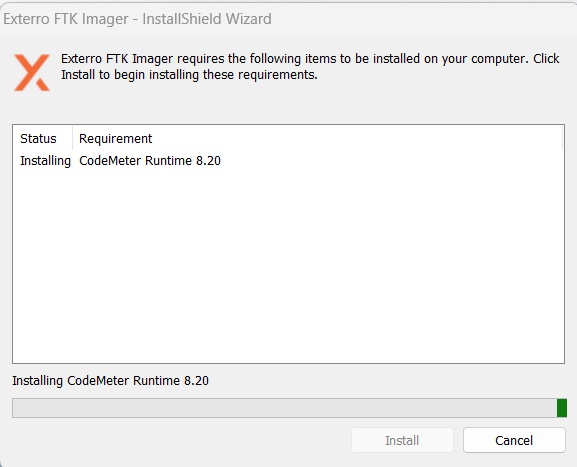
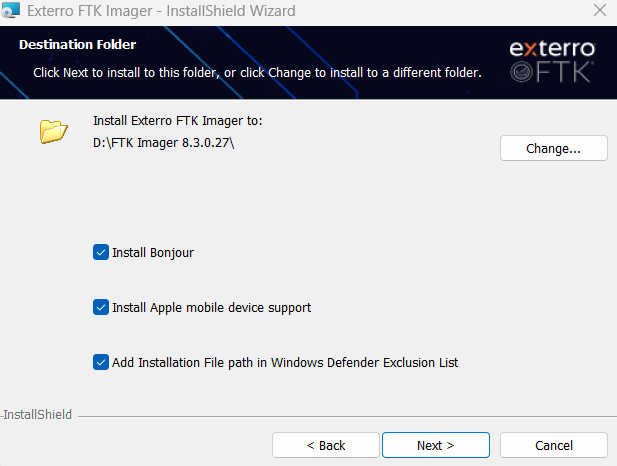
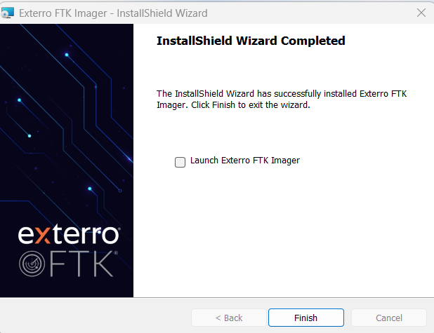

# 02 – Mengunduh dan Menginstal FTK Imager

[← Sebelumnya](01-alat-dan-bahan.md) · [Daftar isi](../README.md) · [Berikutnya: Persiapan media →](03-persiapan-media.md)

## A. Mengunduh

1. Buka Google, cari `download ftk imager`.
2. Pilih hasil **"Download Free FTK Imager 8.3"** dari domain `go.exterro.com`. Itu halaman resmi Exterro untuk versi gratis.
   - Jangan memilih **FTK Imager Pro**. Versi itu berbayar.
   - Jangan mengunduh dari situs mirror seperti Softonic atau FileHorse. Keaslian installer dari situs seperti itu tidak bisa dipastikan.
3. Isi formulir di sisi kanan halaman:

   | Kolom | Isi |
   |---|---|
   | First Name / Last Name | Nama asli |
   | Business Email | **Email kampus** (berakhiran `.ac.id`) |
   | Phone | Nomor HP, contoh `+6281234567890` |
   | Job Title | `Student` |
   | Organization Name | Nama lengkap kampus |
   | Company Country | Indonesia |

4. Centang persetujuan privacy policy, lalu kirim formulir.
5. Link unduhan muncul di halaman atau dikirim ke email. Unduh file installer (±230 MB).

## B. Mengekstrak

File yang terunduh berupa arsip ZIP. Klik kanan → **Extract All** → pilih folder, misalnya `D:\FTK Imager 8.3.0.27`. Hasilnya adalah file **installer** `Exterro_FTK_Imager_(x64).exe` dan folder `ISSetupPrerequisites`. FTK Imager **belum bisa dipakai** sebelum installer ini dijalankan.

## C. Menginstal

1. Klik dua kali `Exterro_FTK_Imager_(x64).exe`, lalu klik **Yes** saat muncul UAC.
2. Installer memasang komponen pendukung **CodeMeter Runtime** terlebih dahulu. Tunggu sampai selesai.

   

3. Pada halaman *Destination Folder*, biarkan lokasi default atau pilih folder lain. Opsi *Install Bonjour*, *Apple mobile device support*, dan *Windows Defender Exclusion* boleh dibiarkan tercentang.

   

4. Klik **Next**, tunggu proses instalasi, lalu klik **Finish**.

   

5. Catat versinya (contoh: **8.3.0.27**) untuk tabel alat dan bahan di laporan.

## D. Menjalankan FTK Imager

Buka dari Start Menu atau shortcut **Exterro FTK Imager** di desktop. FTK Imager membutuhkan hak Administrator untuk membaca physical drive, jadi klik **Yes** kalau muncul UAC.

**Jangan buka FTK Imager dulu** sebelum write blocker aktif ([05-write-blocker.md](05-write-blocker.md)).

## Jika Ada Masalah

| Masalah | Penyebab | Solusi |
|---|---|---|
| Formulir menampilkan *"Please provide valid business email address"* | Exterro menolak email pribadi (Gmail, Yahoo) dan domain yang tidak dikenal | Pakai email kampus. Kalau tetap ditolak, minta installer ke asisten lab atau dosen. |
| Tidak menemukan file unduhan | Browser menyimpan ke folder lain | Buka riwayat unduhan browser (`Ctrl + J`) → *Show in folder*. |
| Setelah diekstrak, tidak ada `FTK Imager.exe` | Isi ZIP adalah installer, bukan aplikasi portabel | Jalankan `Exterro_FTK_Imager_(x64).exe` (bagian C). |
| Instalasi CodeMeter gagal | Antivirus memblokir atau instalasi sebelumnya belum tuntas | Restart laptop, lalu jalankan installer lagi sebagai Administrator (klik kanan → *Run as administrator*). |
| FTK Imager tidak bisa dibuka | Belum terinstal sempurna atau UAC ditolak | Instal ulang. Saat membuka, klik **Yes** di UAC. |
