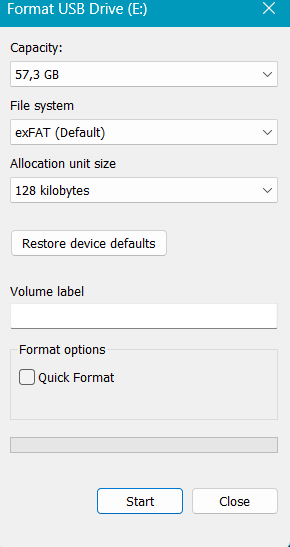

# 03 – Menyiapkan Media Bukti

[← Sebelumnya](02-unduh-instal-ftk-imager.md) · [Daftar isi](../README.md) · [Berikutnya: Membuat skenario →](04-membuat-skenario.md)

## Kenapa Media Harus Diformat Penuh?

1. **Privasi.** Bit-stream imaging menyalin semua sektor, termasuk file lama yang pernah kamu hapus. Tanpa format penuh, file pribadimu bisa muncul di laporan.
2. **Temuan bisa dicocokkan.** Kalau isi media hanya file skenario, setiap temuan bisa dibandingkan dengan kondisi yang kamu ketahui.
3. **Ukuran image kecil.** Sejak Windows Vista, format penuh menulis nol ke seluruh disk. Di format E01, sektor nol hampir tidak memakan ruang.

Modul 04 menyebut langkah ini sebagai *sanitize the target media* dan memberi contoh standar seperti NIST SP 800-88 dan DoD 5220.22-M. Format penuh Windows hanya satu kali penimpaan nol, jadi di laporan sebut sebagai "persiapan media simulasi", bukan sanitasi sesuai standar.

## Langkah

1. **Salin dulu file penting** dari media ke laptop. Semua isi media akan hilang.
2. Buka **This PC**, klik kanan drive media → **Format…**
3. Atur pilihan berikut:

   | Pilihan | Isi | Catatan |
   |---|---|---|
   | Capacity | Biarkan | - |
   | File system | Pilih sesuai skenario: **FAT32**, **exFAT**, atau **NTFS** | Windows hanya menawarkan FAT32 untuk media ≤ 32 GB |
   | Allocation unit size | **Default** | Nilai default bergantung ukuran media (contoh: exFAT 57 GB → 128 KB) |
   | Volume label | Bebas, misalnya `BUKTI01` | Boleh dikosongkan; FTK akan menampilkan `NONAME` |
   | **Quick Format** | **Jangan dicentang** | Ini yang membuat format menjadi format penuh |

   

4. Klik **Start** → **OK** pada peringatan penghapusan data.
5. Tunggu sampai muncul **Format Complete**. Selama proses, jangan mencabut media, jangan menutup jendela, dan jangan biarkan laptop sleep.
6. Screenshot pengaturan format dan pesan *Format Complete* untuk laporan. Catat jam mulai dan jam selesai.

### Perkiraan waktu format penuh

Waktunya bergantung pada kecepatan tulis media (umumnya 10–30 MB/detik):

| Kapasitas | Perkiraan |
|---|---|
| 4 GB | 3–7 menit |
| 16 GB | 10–25 menit |
| 32 GB | 20–50 menit |
| 64 GB | 40–90 menit |

Pada contoh praktik, flash disk 64 GB (USB 2.0) membutuhkan sekitar 65 menit.

## Memilih File System

| File system | Kelebihan untuk tugas ini | Yang bisa dianalisis |
|---|---|---|
| **FAT32** | Materi Modul 03 membahas BPB FAT32 secara rinci | Entri direktori terhapus diawali byte `E5`, tabel FAT, BPB |
| **exFAT** | Default untuk media > 32 GB | Entri `85/C0/C1` menjadi `05/40/41`, allocation bitmap |
| **NTFS** | Modul 03 membahas MFT dan file sistem NTFS | Record MFT `FILE0`, flag record terhapus, `$MFT`, `$Bitmap` |

Pilih sesuai skenario di [daftar skenario](../skenario/README.md). Variasi file system juga membuat laporanmu berbeda dari teman.

## Jika Ada Masalah

| Masalah | Penyebab | Solusi |
|---|---|---|
| Opsi FAT32 tidak muncul | Media > 32 GB; Windows tidak menawarkan FAT32 untuk volume sebesar itu | Pakai exFAT atau NTFS, atau gunakan media ≤ 32 GB. |
| Progress bar lambat | Wajar untuk format penuh, terutama di port USB 2.0 | Tunggu. Pindah ke port USB 3.0 (biasanya berwarna biru) sebelum mulai format. |
| *"Windows was unable to complete the format"* | Media rusak, terkunci, atau sedang dipakai aplikasi lain | Tutup semua jendela yang membuka media, cek saklar *lock* pada SD card, coba port lain. Kalau tetap gagal, ganti media. |
| SD card tidak bisa diformat (*write protected*) | Saklar lock di sisi kartu dalam posisi terkunci | Geser saklar ke posisi tidak terkunci. |
| Quick Format telanjur dicentang | Format hanya menghapus tabel file | Format ulang tanpa Quick Format. Quick Format hanya menghapus tabel file, data lama tetap ada. |
