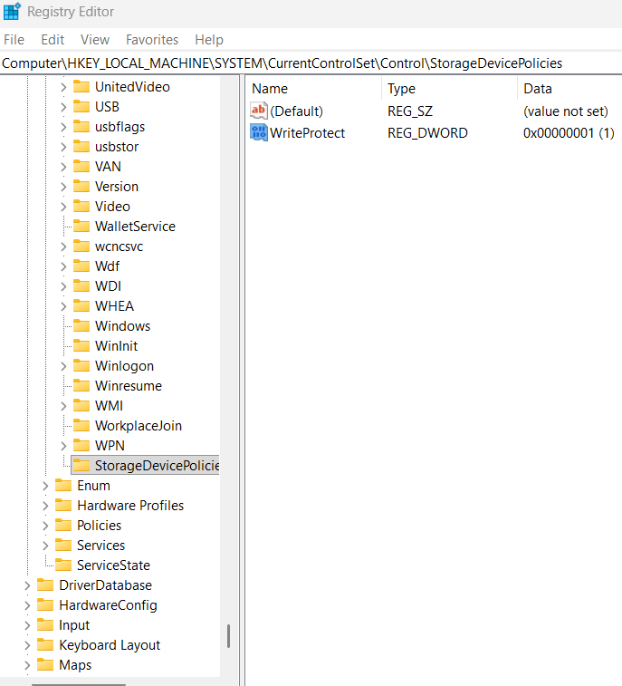
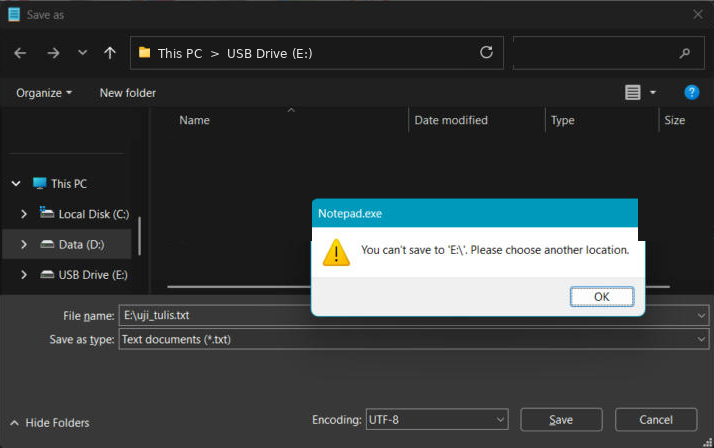

# 05 – Mengaktifkan Write Blocker

[← Sebelumnya](04-membuat-skenario.md) · [Daftar isi](../README.md) · [Berikutnya: Akuisisi →](06-akuisisi.md)

Modul 04 (Step 5: *Enable Write Protection on the Evidence Media*) mewajibkan media bukti dibuat read-only sebelum diakuisisi. Ada dua jenis write blocker:

| Jenis | Contoh | Keterangan |
|---|---|---|
| Hardware | Tableau Forensic Bridge, CRU WiebeTech USB WriteBlocker | Paling aman, tetapi harganya mahal |
| Software | SAFE Block, atau pengaturan registry Windows | Gratis; dipakai di panduan ini |

## A. Mengaktifkan WriteProtect di Registry

1. Tekan `Win + R`, ketik `regedit`, tekan Enter, lalu klik **Yes** di UAC.
2. Klik address bar Registry Editor, tempel alamat berikut, lalu Enter:
   ```
   Computer\HKEY_LOCAL_MACHINE\SYSTEM\CurrentControlSet\Control
   ```
3. Cari key **StorageDevicePolicies** di panel kiri. Kalau sudah ada, key itu berada di antara `Storage` dan `StorageManagement`.
4. Kalau **belum ada**:
   - Klik kanan **area kosong di panel kanan** (posisi masih di key `Control`) → **New → Key**.
   - Beri nama `StorageDevicePolicies`, lalu Enter.
5. Klik key `StorageDevicePolicies`.
6. Klik kanan area kosong di panel kanan → **New → DWORD (32-bit) Value** → beri nama `WriteProtect`.
7. Klik dua kali `WriteProtect`, isi **Value data** dengan `1`, lalu OK.
8. Pastikan panel kanan menampilkan `WriteProtect  REG_DWORD  0x00000001 (1)`, lalu screenshot.

   

9. **Cabut media, tunggu 5 detik, lalu colokkan lagi.** Pengaturan ini hanya berlaku untuk perangkat USB yang dicolokkan setelah nilai diaktifkan.

## B. Menguji Write Protection

Jangan langsung percaya bahwa write blocker aktif. Uji dulu:

1. Buka **Notepad**, ketik teks apa saja.
2. Tekan `Ctrl + Shift + S` (Save As), ketik nama file `E:\uji_tulis.txt` (ganti `E:` dengan huruf drive media), lalu Enter.
3. Windows harus menolak dengan pesan seperti *"You can't save to 'E:\'. Please choose another location."* atau *"The media is write protected"*.
4. Screenshot pesan penolakan itu. Ini bukti write protection di laporan.

   

5. Klik OK → Cancel → tutup tab Notepad tanpa menyimpan (*Don't save*).

## C. Hasil yang Benar

- Registry `WriteProtect = 1`.
- Uji tulis ditolak.
- Isi media di File Explorer tidak berubah.

## Jika Ada Masalah

| Masalah | Penyebab | Solusi |
|---|---|---|
| Key `StorageDevicePolicies` tidak ada | Normal, key ini tidak ada secara default | Buat sendiri (langkah A.4). |
| Klik kanan → New tidak memunculkan *Key* | Klik kanan di tempat yang salah | Klik kanan di area kosong panel kanan, atau klik kanan key `Control` di panel kiri. |
| Nama key/value salah ketik | - | Klik kanan → *Rename*. Nama harus persis `StorageDevicePolicies` dan `WriteProtect`. |
| Uji tulis **berhasil** (file tersimpan) | Media belum dicolok ulang, atau nilai salah | Cek ulang nilai `1`, cabut-colok media, uji lagi. Kalau file uji sempat tersimpan, catat di laporan bahwa ada satu file uji yang tertulis sebelum write blocker aktif, atau ulangi dari [tahap 03](03-persiapan-media.md). |
| SD card lewat card reader internal tidak terkunci | Pengaturan ini hanya berlaku untuk penyimpanan USB; card reader internal kadang memakai bus lain | Pakai card reader USB eksternal, atau geser saklar lock pada SD card sebagai perlindungan tambahan. |
| Semua flash disk lain jadi tidak bisa ditulisi | Efek normal selama `WriteProtect = 1` | Kembalikan ke `0` setelah praktik selesai ([12-mengembalikan-sistem.md](12-mengembalikan-sistem.md)). Eject atau restart tidak cukup. |
