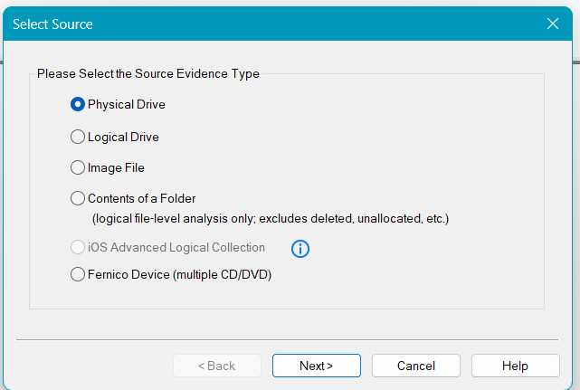
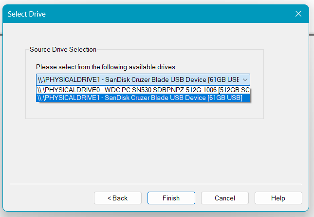
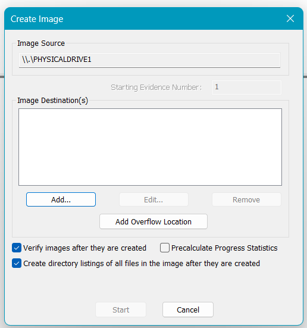
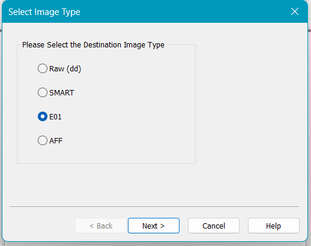
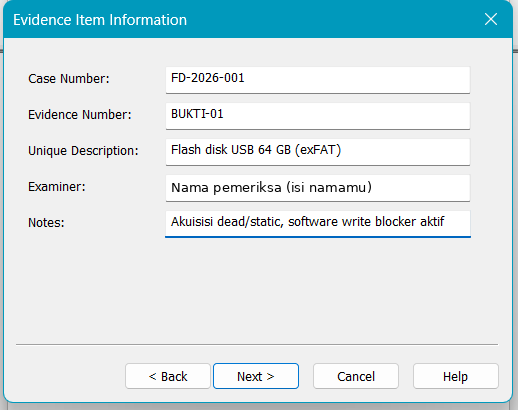
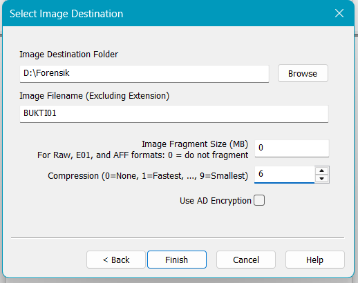
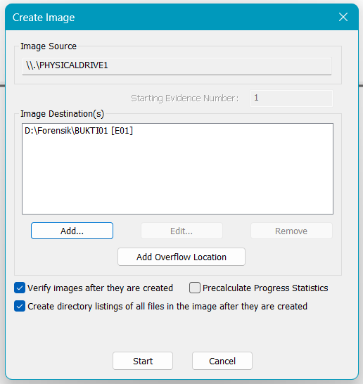
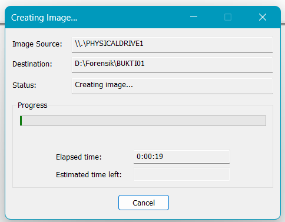

# 06 – Akuisisi Image E01 dengan FTK Imager

[← Sebelumnya](05-write-blocker.md) · [Daftar isi](../README.md) · [Berikutnya: Verifikasi →](07-verifikasi.md)

Langkah ini mengikuti bagian *Creating A Forensics Image* pada materi Ignite dan Step 6 (*Acquire Non-volatile Data*) Modul 04.

## A. Membuka FTK Imager

1. Buka **Exterro FTK Imager**, lalu klik **Yes** di UAC.
2. Maximize jendela (tombol □) supaya screenshot jelas.
3. Screenshot tampilan awal.

## B. Wizard Create Disk Image

1. Klik **File → Create Disk Image…**
2. **Select Source**: pilih **Physical Drive** → Next.

   

   | Pilihan | Yang disalin | Kapan dipakai |
   |---|---|---|
   | Physical Drive | Seluruh perangkat: MBR/GPT, semua partisi, area di luar partisi | **Tugas ini** (bit-stream disk-to-image) |
   | Logical Drive | Satu volume/partisi saja | Kalau hanya satu partisi yang relevan |
   | Image File | Image yang sudah ada | Konversi format image |
   | Contents of a Folder | File tertentu (logical acquisition) | Tidak menyalin file terhapus dan unallocated |

3. **Select Drive**: buka dropdown, pilih media bukti, lalu klik Finish. Cocokkan merek dan kapasitas dengan media. Jangan memilih disk laptop (biasanya `PHYSICALDRIVE0`).

   

4. **Create Image**: centang
   - **Verify images after they are created**
   - **Create directory listings of all files in the image after they are created**

   lalu klik **Add…**

   

5. **Select Image Type**: pilih **E01** → Next.

   

   | Format | Alasan dipilih / tidak |
   |---|---|
   | Raw (dd) | Ukuran sama dengan media, tanpa metadata |
   | SMART | Format lama, jarang dipakai |
   | **E01** | Terkompresi, menyimpan info kasus dan hash di dalam file |
   | AFF | Format terbuka, dukungan alat lebih sedikit |

6. **Evidence Item Information**: isi data kasus. Buat nomor kasus dan bukti versimu sendiri.

   

   | Kolom | Contoh |
   |---|---|
   | Case Number | `FD-2026-001` |
   | Evidence Number | `BUKTI-01` |
   | Unique Description | `Flash disk USB 64 GB (exFAT)` |
   | Examiner | Nama lengkapmu |
   | Notes | `Akuisisi dead/static, software write blocker aktif` |

7. **Select Image Destination**:
   - **Image Destination Folder**: Browse → pilih `D:\Forensik` (atau drive lain yang longgar).
   - **Image Filename**: misalnya `BUKTI01` (tanpa ekstensi).
   - **Image Fragment Size**: `0` (satu file utuh), atau `2048` kalau ruang disk terbatas.
   - **Compression**: `6`.
   - **Use AD Encryption**: jangan dicentang.

   

8. Klik Finish. Di jendela *Create Image*, pastikan tujuan sudah muncul di daftar, lalu screenshot dan klik **Start**.

   

9. Screenshot saat progress bar berjalan. Catat jam mulai.

   

## C. Selama Proses Berjalan

- Jangan mencabut media dan jangan biarkan laptop sleep.
- Untuk media yang diformat penuh, ukuran file `.E01` di folder tujuan bertambah lambat. Itu tanda kompresi bekerja.
- Setelah pembuatan image selesai, FTK langsung menjalankan verifikasi (*Verifying*).

| Kapasitas media | Perkiraan akuisisi (USB 2.0) |
|---|---|
| 8 GB | 5–8 menit |
| 32 GB | 15–25 menit |
| 64 GB | 30–40 menit |

## D. Hasil yang Benar

Folder `D:\Forensik` berisi:

| File | Isi |
|---|---|
| `BUKTI01.E01` | Image forensik |
| `BUKTI01.E01.txt` | Log: info kasus, info media, hash, waktu akuisisi dan verifikasi |
| `BUKTI01.E01.csv` | Directory listing seluruh file di image |

## Jika Ada Masalah

| Masalah | Penyebab | Solusi |
|---|---|---|
| **Low Disk Space Warning**: *"FTK Imager needs 58680 MB… Only 14364 MB are available"* | FTK menghitung skenario terburuk (ukuran media tanpa kompresi) | Kalau media diformat penuh, klik **No** untuk tetap menulis ke lokasi semula; ukuran asli E01 jauh lebih kecil. Pantau ukuran file. Kalau media tidak diformat penuh, ulangi dengan Image Fragment Size `2048` dan siapkan ruang lebih besar. Lihat [troubleshooting](../troubleshooting.md#8-low-disk-space-warning). |
| Daftar drive hanya menampilkan disk laptop | Media belum terbaca, atau FTK tidak dijalankan sebagai Administrator | Tutup FTK, cabut-colok media, buka FTK lagi dan klik Yes di UAC. |
| Proses berhenti dengan error baca (*read error*) | Media rusak atau koneksi USB lepas | Pindah port, ulangi akuisisi. Kalau berulang, catat di laporan dan cek bagian *Bad Blocks List* saat verifikasi. |
| Laptop sleep di tengah proses | Pengaturan daya | *Settings → System → Power → Screen and sleep → Never*, lalu ulangi akuisisi. |
| Salah memilih drive (disk laptop) | - | Klik Cancel secepatnya, hapus file E01 yang terbentuk, ulangi dari langkah B. |
