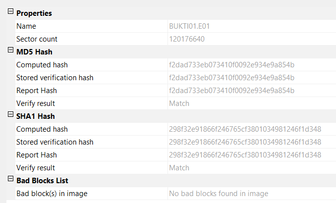
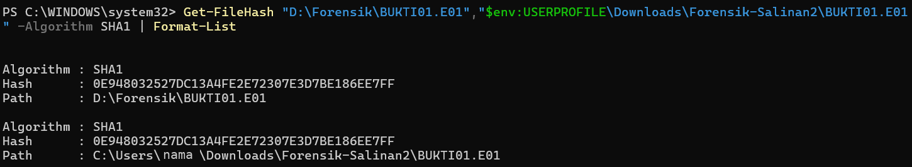

# 07 – Verifikasi Hash dan Salinan Kedua

[← Sebelumnya](06-akuisisi.md) · [Daftar isi](../README.md) · [Berikutnya: Analisis →](08-analisis.md)

Modul 04 Step 8 (*Validate Data Acquisition*) mewajibkan perbandingan hash media asli dengan hash image. Step 7 (*Plan for Contingency*) menganjurkan minimal dua salinan image.

## A. Membaca Hasil Verifikasi FTK

1. Setelah verifikasi selesai, muncul jendela **Drive/Image Verify Results**.
2. Klik tombol **maximize (□)** di jendela itu supaya bagian MD5 dan SHA1 terlihat bersamaan, lalu screenshot.

   

3. Periksa tiga baris di setiap algoritme:

   | Baris | Arti |
   |---|---|
   | Computed hash | Hash yang dihitung dari media sumber saat akuisisi |
   | Stored verification hash | Hash yang disimpan di dalam file E01 |
   | Report hash | Hash yang tercatat di laporan ringkasan |
   | **Verify result** | Harus **Match** |

4. Bagian **Bad Blocks List** harus berisi *No bad blocks found in image*.
5. Klik Close. Di jendela *Creating Image*, klik **Image Summary…**, screenshot, lalu OK dan Close.

## B. Membaca Log

Buka `D:\Forensik\BUKTI01.E01.txt` dengan Notepad. Data penting untuk laporan:

| Data | Letak di log |
|---|---|
| Info kasus | `Case Information` |
| Model dan serial media | `Drive Model`, `Drive Serial Number` |
| Geometri CHS | `Cylinders`, `Tracks per Cylinder`, `Sectors per Track` |
| Jumlah sektor dan ukuran | `Sector Count`, `Source data size` |
| Hash | `MD5 Hash`, `SHA1 Hash` |
| Waktu | `Acquisition started/finished`, `Verification started/finished` |

## C. Membuat Salinan Kedua

1. Salin `BUKTI01.E01` dan `BUKTI01.E01.txt` ke lokasi lain, misalnya `C:\Users\<nama>\Downloads\Forensik-Salinan2\` atau flash disk lain (bukan media bukti).
2. Bandingkan hash kedua salinan dengan PowerShell (`Get-FileHash` disebut langsung di Modul 04 Step 8):

   ```powershell
   Get-FileHash "D:\Forensik\BUKTI01.E01","$env:USERPROFILE\Downloads\Forensik-Salinan2\BUKTI01.E01" -Algorithm SHA1 | Format-List
   ```

3. Kedua nilai `Hash` harus sama. Screenshot hasilnya.

   

## Penting: Hash File E01 ≠ Hash Media

Hash file `BUKTI01.E01` (dari `Get-FileHash`) **pasti berbeda** dengan hash media di log FTK. File E01 berisi header, metadata kasus, dan data terkompresi. Yang membuktikan keaslian bukti adalah hash media (yang dihitung FTK dari data yang direkonstruksi). `Get-FileHash` pada file E01 hanya membuktikan bahwa dua salinan file E01 identik.

Perbandingan langsung `Get-FileHash` dengan hash media hanya berlaku untuk image **Raw (dd) satu segmen**.

## Jika Ada Masalah

| Masalah | Penyebab | Solusi |
|---|---|---|
| Verify result **Mismatch** | Media berubah selama akuisisi, kabel/port bermasalah, atau media rusak | Pastikan write blocker aktif, ganti port, ulangi akuisisi. Kalau tetap mismatch, catat sebagai temuan dan cek Bad Blocks List. |
| Jendela Verify Results kecil dan hash terpotong | Ukuran default jendela | Maximize jendela atau scroll di dalam daftar. |
| Hash `Get-FileHash` berbeda dengan hash di log | Normal untuk E01 | Baca bagian "Penting" di atas. |
| Kedua salinan E01 hash-nya berbeda | Penyalinan belum selesai atau korup | Salin ulang, lalu hitung lagi. |
| `Get-FileHash`: *Cannot find path* | Path salah atau folder belum dibuat | Cek nama folder dengan `dir`, perhatikan tanda kutip. |
