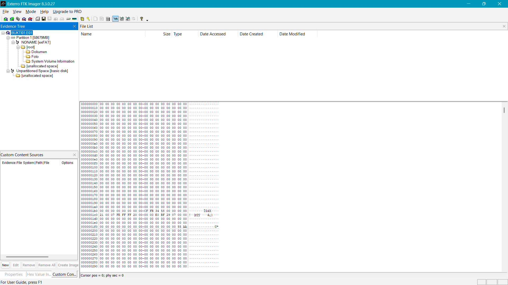
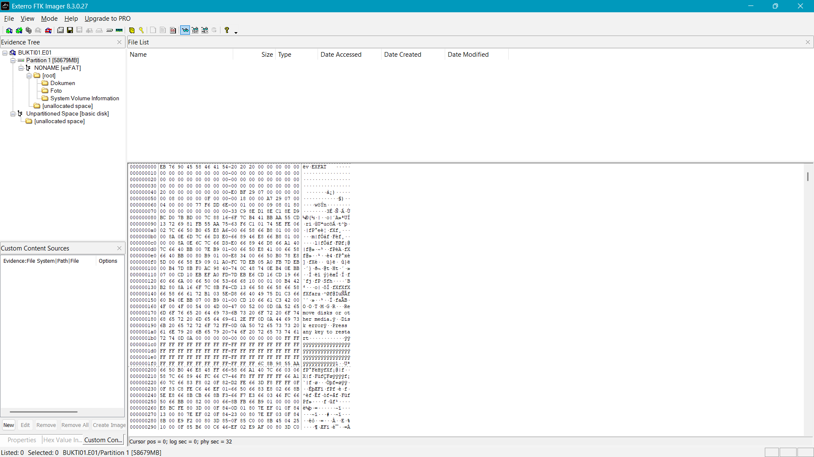
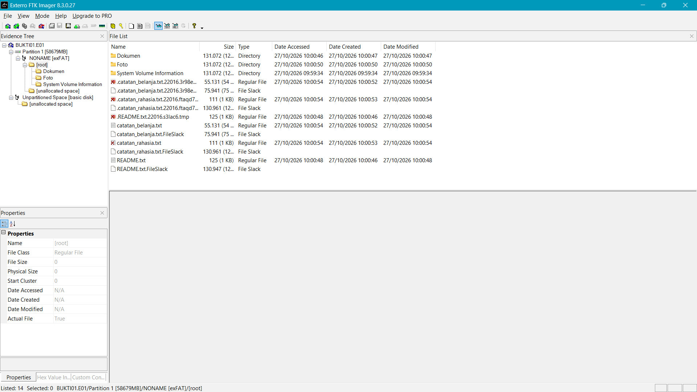
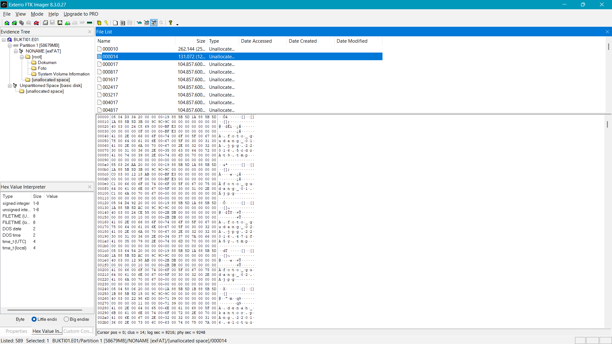
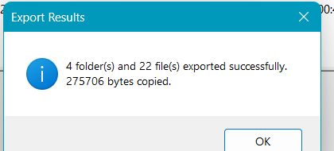

# 08 – Analisis Image

[← Sebelumnya](07-verifikasi.md) · [Daftar isi](../README.md) · [Berikutnya: Validasi alat kedua →](09-validasi-alat-kedua.md)

Analisis selalu dilakukan pada **image**, bukan pada media asli. Bagian ini mengikuti *Analyzing Image Dump* dan *Export Files* pada materi Ignite, serta teori struktur disk di Modul 03.

## Daftar Isi

- [A. Membuka image](#a-membuka-image)
- [B. Mengenal tampilan FTK Imager](#b-mengenal-tampilan-ftk-imager)
- [C. Sektor 0: MBR atau GPT](#c-sektor-0-mbr-atau-gpt)
- [D. Boot sector partisi](#d-boot-sector-partisi)
- [E. Perhitungan CHS dan kapasitas](#e-perhitungan-chs-dan-kapasitas)
- [F. Daftar file dan timestamp](#f-daftar-file-dan-timestamp)
- [G. Slack space](#g-slack-space)
- [H. File terhapus](#h-file-terhapus)
- [I. Unallocated space](#i-unallocated-space)
- [J. Analisis signature](#j-analisis-signature)
- [K. Export Files dan Export File Hash List](#k-export-files-dan-export-file-hash-list)
- [L. Mencocokkan hash dengan referensi](#l-mencocokkan-hash-dengan-referensi)

---

## A. Membuka Image

1. **File → Add Evidence Item…**
2. Pilih **Image File** → Next.
3. Browse → pilih `D:\Forensik\BUKTI01.E01` → Finish.
4. Di *Evidence Tree* akan muncul `BUKTI01.E01`. Klik tanda **+** untuk membuka isinya:

   ```
   BUKTI01.E01
   ├── Partition 1 [58679MB]
   │   └── NONAME [exFAT]          ← nama volume dan file system
   │       ├── [root]
   │       │   ├── Dokumen
   │       │   ├── Foto
   │       │   └── System Volume Information
   │       └── [unallocated space]
   └── Unpartitioned Space [basic disk]
   ```

   Nama dan isinya mengikuti media masing-masing.

## B. Mengenal Tampilan FTK Imager

| Panel | Fungsi |
|---|---|
| Evidence Tree (kiri atas) | Struktur bukti: image → partisi → file system → folder |
| File List (kanan atas) | Isi folder yang dipilih |
| Viewer (kanan bawah) | Isi file/sektor dalam mode Natural, Text, atau Hex |
| Properties / Hex Value Interpreter (kiri bawah) | Detail item yang dipilih, atau arti byte yang disorot |
| Status bar (paling bawah viewer) | `Cursor pos`, `clus` (cluster), `log sec` (sektor logis), `phy sec` (sektor fisik) |

Tombol mode tampilan ada di toolbar, berupa tiga ikon kacamata:

| Ikon | Mode |
|---|---|
| Kacamata tanpa tulisan | Natural/Auto (gambar atau dokumen ditampilkan apa adanya) |
| Kacamata **TEXT** | Teks |
| Kacamata **HEX** | Hexadecimal |

Cara membaca baris hex:

```
000001c0  21 00 07 FE FF FF 20 00-00 00 E0 BF 29 07 00 00   !..þÿÿ ...à¿)...
└offset┘  └──────────── 16 byte data ──────────────────┘   └─ ASCII ──────┘
```

Byte ke-n pada baris itu berada di offset `0x1C0 + n`. Contoh: byte `07` adalah byte ke-2, jadi offset-nya `0x1C2`.

**Little endian.** Angka lebih dari satu byte disimpan dari byte terkecil. `20 00 00 00` dibaca `0x00000020` = 32. `E0 BF 29 07` dibaca `0x0729BFE0` = 120.176.608. Hitung dengan Kalkulator Windows mode **Programmer** (HEX → DEC).

## C. Sektor 0: MBR atau GPT

1. Klik node paling atas (`BUKTI01.E01`), lalu pilih mode **HEX**. Status bar menunjukkan `phy sec = 0`.
2. Lihat dua byte terakhir (offset `0x1FE`). Kalau nilainya `55 AA`, sektor ini adalah MBR atau protective MBR.
3. Screenshot baris `0x1B0` sampai `0x1F0`.

   

Struktur MBR menurut Modul 03 (446 byte kode boot + 64 byte tabel partisi + 2 byte signature):

| Offset | Ukuran | Isi | Contoh nilai |
|---|---|---|---|
| `0x000`–`0x1BD` | 446 byte | Kode boot | Semua nol (flash disk tidak bootable) |
| `0x1B8` | 4 byte | Disk signature | `CF FB 34 58` → `0x5834FBCF` |
| `0x1BE` | 16 byte | Entri partisi 1 | lihat di bawah |
| `0x1CE`, `0x1DE`, `0x1EE` | 16 byte | Entri partisi 2–4 | Kosong |
| `0x1FE` | 2 byte | Signature | `55 AA` |

Isi satu entri partisi (16 byte, mulai `0x1BE`):

| Offset entri | Absolut | Isi | Contoh |
|---|---|---|---|
| +0 | `0x1BE` | Flag boot (`80` = bootable, `00` = tidak) | `00` |
| +1..+3 | `0x1BF` | CHS awal | `00 21 00` |
| +4 | `0x1C2` | **Tipe partisi** | `07` |
| +5..+7 | `0x1C3` | CHS akhir | `FE FF FF` |
| +8..+11 | `0x1C6` | **LBA awal** | `20 00 00 00` = sektor 32 |
| +12..+15 | `0x1CA` | **Jumlah sektor** | `E0 BF 29 07` = 120.176.608 |

Kode tipe partisi yang sering muncul:

| Kode | File system |
|---|---|
| `07` | NTFS atau exFAT |
| `0B` | FAT32 (CHS) |
| `0C` | FAT32 (LBA) |
| `EE` | Protective MBR → disk memakai **GPT** |

**Cek konsistensi:** LBA awal + jumlah sektor ≤ total sektor di log. Pada contoh praktik, 32 + 120.176.608 = 120.176.640, persis total sektor media.

**Kalau tipe partisinya `EE` (GPT):** klik node image, scroll ke offset `0x200` (sektor 1). Header GPT diawali teks `EFI PART`. Modul 03 menjelaskan struktur GPT (LBA 0 protective MBR, LBA 1 header GPT, LBA 2–33 entri partisi).

## D. Boot Sector Partisi

Klik **Partition 1** di Evidence Tree, lalu pilih mode HEX. Status bar menunjukkan `log sec = 0; phy sec = <LBA awal>`. Screenshot 8 baris pertama dan baris `0x1F0`.



Klik juga tab **Properties** (kiri bawah) untuk melihat *Starting Sector* dan *Sector Count*.

### D.1 exFAT

Sumber: Microsoft *exFAT File System Specification*.

| Offset | Ukuran | Field | Contoh |
|---|---|---|---|
| `0x03` | 8 | FileSystemName | `EXFAT␣␣␣` |
| `0x40` | 8 | PartitionOffset | 32 |
| `0x48` | 8 | VolumeLength (sektor) | 120.176.608 |
| `0x50` | 4 | FatOffset | 2.048 |
| `0x54` | 4 | FatLength | 3.840 |
| `0x58` | 4 | ClusterHeapOffset | 6.144 |
| `0x5C` | 4 | ClusterCount | 469.415 |
| `0x60` | 4 | FirstClusterOfRootDirectory | 4 |
| `0x64` | 4 | VolumeSerialNumber | `6EDDF677` |
| `0x6C` | 1 | BytesPerSectorShift | 9 → 2⁹ = 512 |
| `0x6D` | 1 | SectorsPerClusterShift | 8 → 2⁸ = 256 sektor = 128 KB |
| `0x1FE` | 2 | BootSignature | `55 AA` |

Rumus lokasi cluster: **sektor = ClusterHeapOffset + (nomor cluster − 2) × sektor per cluster**. Cluster pertama bernomor 2.

### D.2 FAT32

Sumber: tabel BPB FAT32 di Modul 03.

| Offset | Ukuran | Field |
|---|---|---|
| `0x03` | 8 | OEM name, biasanya `MSDOS5.0` |
| `0x0B` | 2 | Bytes per sector (umumnya 512) |
| `0x0D` | 1 | Sectors per cluster |
| `0x0E` | 2 | Reserved sectors (sektor sebelum FAT pertama) |
| `0x10` | 1 | Jumlah FAT (umumnya 2) |
| `0x1C` | 4 | Hidden sectors (= LBA awal partisi) |
| `0x20` | 4 | Total sectors |
| `0x24` | 4 | Sectors per FAT |
| `0x2C` | 4 | Cluster root directory (umumnya 2) |
| `0x30` | 2 | Lokasi FSInfo sector |
| `0x32` | 2 | Lokasi backup boot sector (umumnya 6) |
| `0x43` | 4 | Volume serial number |
| `0x47` | 11 | Volume label |
| `0x52` | 8 | File system type, `FAT32␣␣␣` |
| `0x1FE` | 2 | Signature `55 AA` |

Lokasi area data FAT32: **reserved sectors + (jumlah FAT × sectors per FAT)**.

### D.3 NTFS

Sumber: tabel BPB NTFS di Modul 03.

| Offset | Ukuran | Field |
|---|---|---|
| `0x03` | 8 | OEM ID, `NTFS␣␣␣␣` |
| `0x0B` | 2 | Bytes per sector |
| `0x0D` | 1 | Sectors per cluster |
| `0x28` | 8 | Total sectors |
| `0x30` | 8 | Cluster awal `$MFT` |
| `0x38` | 8 | Cluster awal `$MFTMirr` |
| `0x40` | 1 | Ukuran record MFT (nilai `F6` berarti 2¹⁰ = 1024 byte) |
| `0x48` | 8 | Volume serial number |
| `0x1FE` | 2 | Signature `55 AA` |

## E. Perhitungan CHS dan Kapasitas

Modul 03 memberi rumus: **kapasitas = cylinder × head × sektor per track × 512**. Ambil angkanya dari log (`Cylinders`, `Tracks per Cylinder`, `Sectors per Track`).

Contoh dari praktik:

```
7.480 × 255 × 63 × 512 = 61.525.094.400 byte  (120.166.200 sektor)
Sektor sebenarnya (Sector Count)           = 120.176.640
Selisih                                    = 10.440 sektor
```

Selisih terjadi karena geometri CHS hanya terjemahan untuk kompatibilitas: Windows membulatkan ke bawah ke jumlah cylinder penuh (1 cylinder = 255 × 63 = 16.065 sektor). Kapasitas yang benar memakai *Sector Count* × 512.

## F. Daftar File dan Timestamp

1. Klik **[root]**. File List menampilkan file dan folder. File terhapus ditandai **silang merah**.
2. Kalau barisnya terpotong, seret garis batas antara File List dan Viewer ke bawah.
3. Lihat jumlah item di status bar (`Listed: 14`), pastikan semuanya terlihat, lalu screenshot.
4. Ulangi untuk setiap folder.

   

Yang perlu dicatat:

| Kolom/item | Penjelasan |
|---|---|
| Date Accessed/Created/Modified | FTK menampilkan waktu dalam **UTC**. WIB = UTC + 7 jam. |
| `.FileSlack` | Slack space milik file (lihat bagian G) |
| Entri `.namafile.xxxx.tmp` terhapus | Jejak aplikasi penyalin yang menulis ke file sementara lalu mengganti namanya. Tidak selalu muncul; bergantung cara file disalin. |
| `System Volume Information` | Folder yang dibuat Windows, bukan bagian skenario |

## G. Slack Space

Modul 03: file selalu menempati cluster utuh, sisa ruangnya disebut slack space.

```
slack = (jumlah cluster yang dipakai × ukuran cluster) − ukuran file
```

Contoh: `catatan_belanja.txt` 55.131 byte, cluster 128 KB (131.072 byte) → slack 75.941 byte. FTK menampilkan angka ini pada baris `catatan_belanja.txt.FileSlack`. Bandingkan hitunganmu dengan angka FTK.

## H. File Terhapus

1. Klik file bertanda silang merah.
2. Lihat isinya di mode HEX atau TEXT, lalu screenshot.
3. Catat nama, ukuran, dan cluster awal (status bar `clus =` atau panel Properties → *Start Cluster*).

Mekanisme penghapusan berbeda di setiap file system:

| File system | Yang berubah saat file dihapus | Yang tetap ada |
|---|---|---|
| exFAT | Byte tipe entri direktori bit ke-7 dinolkan: `85→05`, `C0→40`, `C1→41`; bit cluster di allocation bitmap dinolkan | Nama, ukuran, cluster awal, isi cluster |
| FAT32 | Byte pertama entri direktori diganti `E5`; rantai cluster di FAT dinolkan | Sisa nama (karakter pertama hilang), ukuran, cluster awal, isi cluster |
| NTFS | Flag record MFT (offset `0x16`) berubah dari `01` (in use) menjadi `00`; bit di `$Bitmap` dinolkan | Record MFT lengkap, isi cluster |

**Melihat entri direktori exFAT di FTK Imager.** Pada contoh praktik, potongan unallocated `000014` ternyata menampilkan cluster 14, yaitu direktori folder `Foto` (lihat bagian I). Entri aktif terlihat sebagai `85 … C0 … C1` dan entri terhapus sebagai `05 … 40 … 41`:



**Melihat record MFT di NTFS.** Klik file `$MFT` di [root], lalu mode HEX. Setiap record berukuran 1024 byte dan diawali `46 49 4C 45` (`FILE`). Byte di offset `0x16` setiap record adalah flag (`01` file aktif, `03` folder aktif, `00` file terhapus, `02` folder terhapus).

## I. Unallocated Space

1. Klik **[unallocated space]** di bawah nama file system.
2. File List menampilkan potongan bernama angka (misalnya `000010`, `000014`, `000017`). FTK memakai angka itu sebagai nomor cluster awal potongan.
3. Klik potongan, pilih mode HEX, cocokkan `clus =` di status bar dengan nama potongan, lalu screenshot.
4. Cari byte awal yang dikenal (`FF D8 FF`, `25 50 44 46`, `50 4B 03 04`) atau teks yang terbaca di kolom ASCII.

> **Catatan exFAT pada FTK Imager 8.3.0.27.** Pada contoh praktik, isi potongan unallocated exFAT bergeser dua cluster: potongan `000010` (seharusnya cluster kosong 12–13) menampilkan data cluster 10 yang masih terpakai. Akibatnya beberapa file terhapus tampil kosong dan terekspor 0 byte. Kalau kamu mengalami hal serupa, validasi dengan alat kedua ([09-validasi-alat-kedua.md](09-validasi-alat-kedua.md)) dan bahas sebagai temuan di laporan.

## J. Analisis Signature

Bandingkan ekstensi setiap file dengan byte awalnya (mode HEX, baris `0000`):

| Byte awal | Teks ASCII | Jenis file |
|---|---|---|
| `FF D8 FF E0` / `FF D8 FF E1` | `ÿØÿà` / `ÿØÿá` | JPEG (JFIF / EXIF) |
| `89 50 4E 47 0D 0A 1A 0A` | `.PNG....` | PNG |
| `25 50 44 46` | `%PDF` | PDF |
| `50 4B 03 04` | `PK..` | ZIP, DOCX, XLSX, PPTX |
| `D0 CF 11 E0` | - | DOC/XLS lama (OLE) |
| `47 49 46 38` | `GIF8` | GIF |
| `4D 5A` | `MZ` | Program Windows (EXE/DLL) |
| `52 61 72 21` | `Rar!` | RAR |

File dengan ekstensi yang tidak cocok dengan signature-nya adalah *signature mismatch*. Contoh: `catatan_belanja.txt` diawali `FF D8 FF E0 … JFIF`, jadi sebenarnya JPEG.

Perhatikan juga metadata yang terbaca di kolom ASCII: `Exif` (foto kamera, berisi merek HP dan waktu foto), `c2pa`/`jumb` (Content Credentials dari aplikasi pembuat), `Microsoft Office` (dokumen Office), `ReportLab` atau `Microsoft Word` (pembuat PDF).

## K. Export Files dan Export File Hash List

1. Klik kanan **[root] → Export Files…**
2. Pilih `D:\Forensik`, klik **Make New Folder**, lalu **ketik nama** `Ekspor` sebelum OK (kalau tidak, nama foldernya tetap `New folder`).
3. Screenshot ringkasan *Export Results* (jumlah folder, file, dan byte).

   

4. Klik kanan **[root] → Export File Hash List…** → simpan sebagai `D:\Forensik\hash_list.csv`.

## L. Mencocokkan Hash dengan Referensi

Jalankan di PowerShell:

```powershell
$ref = Import-Csv D:\Forensik\hash_referensi.csv
$ftk = Import-Csv D:\Forensik\hash_list.csv
$ref | ForEach-Object {
  $md5 = $_.MD5
  [PSCustomObject]@{
    File          = Split-Path $_.Path -Leaf
    MD5_Referensi = $md5
    Cocok_di_FTK  = [bool]($ftk | Where-Object { $_.MD5 -eq $md5 })
  }
} | Format-Table -AutoSize
```

Kolom `Cocok_di_FTK` bernilai `True` kalau ada file hasil ekspor FTK dengan MD5 yang sama. File yang bernilai `False` perlu dicek lagi dan divalidasi dengan alat kedua. Hash `d41d8cd98f00b204e9800998ecf8427e` di `hash_list.csv` berarti file kosong (0 byte).

Untuk melihat ukuran file hasil ekspor:

```powershell
Get-ChildItem D:\Forensik\Ekspor -Recurse -File | Select-Object Length, FullName | Format-Table -AutoSize
```

## Jika Ada Masalah

| Masalah | Penyebab | Solusi |
|---|---|---|
| Panel Natural kosong saat memilih foto | Penampil FTK kadang tidak merender | Ganti ke mode HEX. Signature `FF D8 FF` sudah cukup sebagai bukti. |
| Mode HEX juga kosong (`Cursor pos = 0`) untuk file terhapus | FTK menganggap cluster file sudah tertimpa (lihat catatan exFAT di bagian I) | Validasi dengan alat kedua. Catat sebagai keterbatasan alat. |
| Hasil ekspor file terhapus 0 byte | Sama seperti di atas | Sama seperti di atas. |
| Tidak menemukan menu *Go to Offset* | Menu itu tidak ada di klik kanan toolbar; di area hex pun belum tentu tersedia di versi 8.3 | Klik kanan di dalam area angka hex. Kalau tetap tidak ada, buka lokasi lewat potongan `[unallocated space]`, file, atau folder yang relevan. |
| Klik kanan memunculkan menu Tool Bar/Evidence Tree | Klik kanan mengenai toolbar | Klik kanan di dalam area angka hex. |
| File List hanya menampilkan sebagian file | Panel terlalu pendek | Seret garis batas ke bawah, atau scroll. |
| Timestamp berbeda 7 jam dari catatanmu | FTK menampilkan UTC | WIB = UTC + 7. |
| Folder ekspor bernama `New folder` | Nama folder baru tidak diganti sebelum OK | Ganti nama di File Explorer setelah ekspor selesai. |
