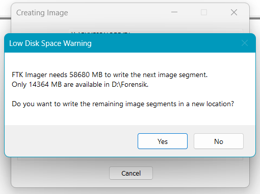

# Troubleshooting

[← Daftar isi](README.md)

Nomor 1–24 muncul selama praktik saat panduan ini disusun. Nomor 25–50 bertanda *(umum)*: belum terjadi di praktik ini, tetapi sering dialami saat mengerjakan tugas serupa. Setiap masalah ditulis dengan gejala, penyebab, dan solusi. Kalau menemukan masalah yang belum ada di sini, catat gejalanya, ambil screenshot, lalu tanyakan ke asisten lab atau dosen.

## Daftar Masalah

1. [Formulir unduhan menolak email](#1-formulir-unduhan-menolak-email)
2. [FTK Imager tidak ditemukan setelah diekstrak](#2-ftk-imager-tidak-ditemukan-setelah-diekstrak)
3. [Flash disk 64 GB dan ruang disk tidak cukup](#3-flash-disk-64-gb-dan-ruang-disk-tidak-cukup)
4. [Flash disk hanya dikosongkan, tidak diformat](#4-flash-disk-hanya-dikosongkan-tidak-diformat)
5. [Format penuh lama sekali](#5-format-penuh-lama-sekali)
6. [Key StorageDevicePolicies tidak ada](#6-key-storagedevicepolicies-tidak-ada)
7. [Write blocker belum aktif](#7-write-blocker-belum-aktif)
8. [Low Disk Space Warning](#8-low-disk-space-warning)
9. [Hash file E01 berbeda dengan hash di log](#9-hash-file-e01-berbeda-dengan-hash-di-log)
10. [Jendela Verify Results terpotong](#10-jendela-verify-results-terpotong)
11. [File List tidak menampilkan semua file](#11-file-list-tidak-menampilkan-semua-file)
12. [Bingung mencari boot sector](#12-bingung-mencari-boot-sector)
13. [Ikon Natural tidak ditemukan atau tampilan kosong](#13-ikon-natural-tidak-ditemukan-atau-tampilan-kosong)
14. [File terhapus exFAT kosong atau terekspor 0 byte](#14-file-terhapus-exfat-kosong-atau-terekspor-0-byte)
15. [Isi unallocated space tidak sesuai dugaan](#15-isi-unallocated-space-tidak-sesuai-dugaan)
16. [Menu Go to Offset tidak ada](#16-menu-go-to-offset-tidak-ada)
17. [Muncul entri .tmp terhapus yang tidak dibuat](#17-muncul-entri-tmp-terhapus-yang-tidak-dibuat)
18. [Timestamp berbeda 7 jam](#18-timestamp-berbeda-7-jam)
19. [Folder ekspor bernama New folder](#19-folder-ekspor-bernama-new-folder)
20. [Screenshot Win+PrtSc tidak ditemukan](#20-screenshot-winprtsc-tidak-ditemukan)
21. [Unmount image](#21-unmount-image)
22. [Metadata C2PA muncul di file gambar](#22-metadata-c2pa-muncul-di-file-gambar)
23. [Data pribadi terlihat di screenshot](#23-data-pribadi-terlihat-di-screenshot)
24. [Tabel laporan terpotong antarhalaman](#24-tabel-laporan-terpotong-antarhalaman)
25. [Flash disk tetap read-only setelah praktik](#25-flash-disk-tetap-read-only-setelah-praktik-umum)

**Masalah umum lain** (belum terjadi di praktik ini, tetapi sering dialami):

26. [Email link unduhan FTK Imager tidak masuk](#26-email-link-unduhan-ftk-imager-tidak-masuk-umum)
27. [Installer diblokir SmartScreen atau antivirus](#27-installer-diblokir-smartscreen-atau-antivirus-umum)
28. [Windows berbahasa Indonesia sehingga nama menu berbeda](#28-windows-berbahasa-indonesia-sehingga-nama-menu-berbeda-umum)
29. [Laptop memakai macOS atau Linux](#29-laptop-memakai-macos-atau-linux-umum)
30. [Windows dalam S mode](#30-windows-dalam-s-mode-umum)
31. [Flash disk terenkripsi BitLocker To Go](#31-flash-disk-terenkripsi-bitlocker-to-go-umum)
32. [Muncul pesan You need to format the disk](#32-muncul-pesan-you-need-to-format-the-disk-umum)
33. [Muncul pesan Scan and fix](#33-muncul-pesan-scan-and-fix-umum)
34. [Jendela AutoPlay muncul saat media dicolok](#34-jendela-autoplay-muncul-saat-media-dicolok-umum)
35. [Folder System Volume Information muncul di media](#35-folder-system-volume-information-muncul-di-media-umum)
36. [Kapasitas flash disk palsu](#36-kapasitas-flash-disk-palsu-umum)
37. [Media tidak terdeteksi sama sekali](#37-media-tidak-terdeteksi-sama-sekali-umum)
38. [FTK Imager tidak bisa membuka physical drive](#38-ftk-imager-tidak-bisa-membuka-physical-drive-umum)
39. [Akuisisi sangat lambat](#39-akuisisi-sangat-lambat-umum)
40. [Laptop mati atau restart saat akuisisi](#40-laptop-mati-atau-restart-saat-akuisisi-umum)
41. [Antivirus mengunci atau menghapus file E01](#41-antivirus-mengunci-atau-menghapus-file-e01-umum)
42. [Ruang disk habis di tengah akuisisi](#42-ruang-disk-habis-di-tengah-akuisisi-umum)
43. [Ada bad sector pada media](#43-ada-bad-sector-pada-media-umum)
44. [Image tidak bisa dibuka di FTK Imager](#44-image-tidak-bisa-dibuka-di-ftk-imager-umum)
45. [File system tidak dikenali FTK Imager](#45-file-system-tidak-dikenali-ftk-imager-umum)
46. [Nilai di Hex Value Interpreter terasa salah](#46-nilai-di-hex-value-interpreter-terasa-salah-umum)
47. [CSV dari FTK berantakan saat dibuka di Excel](#47-csv-dari-ftk-berantakan-saat-dibuka-di-excel-umum)
48. [Perintah PowerShell error](#48-perintah-powershell-error-umum)
49. [Laporan lebih dari 10 halaman](#49-laporan-lebih-dari-10-halaman-umum)
50. [Ukuran PDF terlalu besar untuk diunggah](#50-ukuran-pdf-terlalu-besar-untuk-diunggah-umum)

---

### 1. Formulir unduhan menolak email

- **Gejala:** *"Please provide valid business email address"*.
- **Penyebab:** Exterro hanya menerima email organisasi. Gmail, Yahoo, dan domain asal-asalan ditolak.
- **Solusi:** Pakai email kampus (`.ac.id`) dan nama organisasi lengkap. Kalau tidak punya, minta installer ke asisten lab. Jangan mengunduh dari situs mirror.

### 2. FTK Imager tidak ditemukan setelah diekstrak

- **Gejala:** Setelah ZIP diekstrak, aplikasi FTK Imager tidak ada di Start Menu.
- **Penyebab:** Isi ZIP adalah installer `Exterro_FTK_Imager_(x64).exe`, bukan aplikasi portabel.
- **Solusi:** Jalankan installer itu ([panduan 02](panduan/02-unduh-instal-ftk-imager.md#c-menginstal)).

### 3. Flash disk 64 GB dan ruang disk tidak cukup

- **Gejala:** Drive C: hanya tersisa < 1 GB, D: ±14 GB, sedangkan media 64 GB.
- **Penyebab:** Bit-stream imaging menyalin semua sektor.
- **Solusi:** Format penuh media terlebih dahulu ([panduan 03](panduan/03-persiapan-media.md)). Sektor nol terkompresi, sehingga E01 dari media 57 GB hanya 107 MB. Alternatif lain: pakai media 4–16 GB.

### 4. Flash disk hanya dikosongkan, tidak diformat

- **Gejala:** File lama sudah dihapus, tetapi media tidak diformat.
- **Penyebab:** Menghapus file hanya mengubah entri direktori; isi cluster lama tetap ada.
- **Akibat:** File pribadimu muncul sebagai file terhapus di FTK, dan E01 membengkak.
- **Solusi:** Format penuh (Quick Format tidak dicentang).

### 5. Format penuh lama sekali

- **Gejala:** Progress bar baru 10% setelah 7 menit.
- **Penyebab:** Windows menulis nol ke setiap sektor. Kecepatannya bergantung pada media dan port USB.
- **Solusi:** Tunggu (64 GB bisa 60–90 menit). Matikan sleep: *Settings → System → Power → Screen and sleep → Never*. Gunakan port USB 3.0.

### 6. Key StorageDevicePolicies tidak ada

- **Gejala:** Di `HKLM\SYSTEM\CurrentControlSet\Control` tidak ada `StorageDevicePolicies`.
- **Penyebab:** Key ini memang tidak ada secara default.
- **Solusi:** Klik kanan area kosong panel kanan (posisi di key `Control`) → *New → Key* → `StorageDevicePolicies`. Lalu buat DWORD `WriteProtect = 1` di dalamnya ([panduan 05](panduan/05-write-blocker.md)).

### 7. Write blocker belum aktif

- **Gejala:** Uji tulis berhasil menyimpan file ke media.
- **Penyebab:** Media tidak dicolok ulang setelah registry diubah, atau nilai bukan `1`.
- **Solusi:** Cek nilai, cabut-colok media, uji lagi. Kalau ada file uji yang telanjur tersimpan, catat di laporan atau ulangi persiapan media.

### 8. Low Disk Space Warning

- **Gejala:** *"FTK Imager needs 58680 MB to write the next image segment. Only 14364 MB are available… Do you want to write the remaining image segments in a new location?"*

  

- **Penyebab:** FTK menghitung kebutuhan terburuk, yaitu ukuran media tanpa kompresi.
- **Solusi:**
  - Media diformat penuh → klik **No** (tetap di lokasi semula). Pantau ukuran file E01 di File Explorer; ukurannya akan jauh di bawah ruang kosong.
  - Media tidak diformat penuh → Cancel, format penuh dulu, atau siapkan ruang sebesar kapasitas media.
  - Alternatif: ulangi dengan *Image Fragment Size* `2048` supaya FTK hanya mengecek ruang per 2 GB.
- **Untuk laporan:** bahas sebagai contoh *plan for contingency* (Modul 04 Step 7).

### 9. Hash file E01 berbeda dengan hash di log

- **Gejala:** `Get-FileHash BUKTI01.E01` menghasilkan nilai berbeda dari `MD5 Hash` di log.
- **Penyebab:** File E01 berisi header, metadata, dan data terkompresi. Hash di log adalah hash media.
- **Solusi:** Tidak ada yang salah. Gunakan `Get-FileHash` hanya untuk membandingkan dua salinan file E01. Untuk menghitung ulang hash media dari E01, pakai `ewfhash.py` ([panduan 09](panduan/09-validasi-alat-kedua.md)).

### 10. Jendela Verify Results terpotong

- **Gejala:** Hanya bagian SHA1 yang terlihat.
- **Solusi:** Klik tombol maximize (□) di jendela itu, atau scroll ke atas di dalam daftar.

### 11. File List tidak menampilkan semua file

- **Gejala:** Status bar `Listed: 14`, tetapi baru 10 baris yang terlihat.
- **Solusi:** Seret garis batas antara File List dan panel hex ke bawah.

### 12. Bingung mencari boot sector

- **Gejala:** Tidak tahu di mana "hex boot sector exFAT".
- **Solusi:** Klik **Partition 1** di Evidence Tree dan pilih mode HEX. Tampilan yang muncul adalah boot sector. Buktinya: status bar `phy sec = <LBA awal partisi>` dan baris pertama memuat teks `EXFAT`, `FAT32`, atau `NTFS`.

### 13. Ikon Natural tidak ditemukan atau tampilan kosong

- **Gejala:** Mencari tombol Natural; atau panel kosong saat memilih foto.
- **Penjelasan:** Natural adalah ikon **kacamata tanpa tulisan** di toolbar, di sebelah kiri kacamata TEXT dan HEX. Penampil FTK 8.3 kadang tidak merender gambar.
- **Solusi:** Pakai mode HEX. Signature `FF D8 FF E0 … JFIF` sudah cukup sebagai bukti isi JPEG.

### 14. File terhapus exFAT kosong atau terekspor 0 byte

- **Gejala:** File terhapus terdaftar dengan ukuran benar, tetapi mode HEX kosong (`Cursor pos = 0`) dan hasil *Export Files* 0 byte (MD5 `d41d8cd98f00b204e9800998ecf8427e`).
- **Penyebab (hasil pengamatan saat praktik):** FTK Imager 8.3.0.27 membaca allocation bitmap exFAT bergeser dua cluster. File terhapus di cluster *c* hanya bisa dibaca jika cluster *c+2* kosong. Spesifikasi exFAT menetapkan bit pertama bitmap mewakili cluster 2, dan FTK tampaknya tidak memperhitungkan angka 2 itu.
- **Solusi:** Pulihkan dengan alat kedua (Autopsy atau skrip `recover.py`), cocokkan hash dengan referensi, lalu bahas di laporan sebagai keterbatasan alat dan alasan validasi dengan alat kedua.
- **Catatan:** Masalah ini hanya teramati pada exFAT. FAT32 dan NTFS belum diuji.

### 15. Isi unallocated space tidak sesuai dugaan

- **Gejala:** Potongan `[unallocated space]/000010` berisi file yang masih aktif.
- **Penyebab:** Sama dengan nomor 14 (khusus exFAT pada FTK Imager 8.3.0.27).
- **Cara membuktikan:** Cocokkan `clus =` di status bar dengan data yang tampil, lalu bandingkan dengan status cluster dari `bitmap.py`.

### 16. Menu Go to Offset tidak ada

- **Gejala:** Klik kanan hanya memunculkan menu *Tool Bar, Evidence Tree, File List, Properties, …*
- **Penyebab:** Klik kanan mengenai toolbar.
- **Solusi:** Klik kanan di dalam area angka hex. Kalau tetap tidak ada, buka lokasi lewat file, folder, atau potongan unallocated yang relevan.

### 17. Muncul entri .tmp terhapus yang tidak dibuat

- **Gejala:** Setiap file punya pasangan terhapus bernama `.namafile.22016.xxxxxx.tmp`.
- **Penyebab:** Aplikasi penyalin menulis isi ke file sementara lalu mengganti namanya. Pada exFAT, penggantian nama membuat set entri baru dan menandai set lama tidak terpakai.
- **Solusi:** Bukan error. Catat sebagai temuan. Kalau file disalin dengan File Explorer biasa, entri seperti ini biasanya tidak muncul.

### 18. Timestamp berbeda 7 jam

- **Penyebab:** FTK menampilkan waktu dalam UTC.
- **Solusi:** WIB = UTC + 7, WITA = UTC + 8, WIT = UTC + 9. Sebutkan konversinya di laporan.

### 19. Folder ekspor bernama New folder

- **Penyebab:** Setelah *Make New Folder*, nama tidak diketik sebelum OK.
- **Solusi:** Ganti nama folder di File Explorer setelah ekspor selesai. Isi folder tidak berubah.

### 20. Screenshot Win+PrtSc tidak ditemukan

- **Gejala:** Folder `Pictures\Screenshots` kosong atau tidak ada.
- **Penyebab:** OneDrive mencadangkan folder Pictures.
- **Solusi:** Buka `C:\Users\<nama>\OneDrive\Pictures\Screenshots`.

### 21. Unmount image

- **Gejala:** Bingung memilih baris yang di-unmount (`PhysicalDrive2` dan `F:`).
- **Solusi:** Pilih baris `PhysicalDriveN` → Unmount. Biasanya partisinya ikut terlepas. Kalau masih ada, Unmount juga baris huruf drive-nya.

### 22. Metadata C2PA muncul di file gambar

- **Gejala:** Hex file gambar memuat `jumb`, `c2pa`, atau nama aplikasi pembuat.
- **Penyebab:** Gambar dibuat atau diproses aplikasi yang menyisipkan Content Credentials, misalnya generator gambar AI.
- **Solusi:** Bukan error. Laporkan apa adanya sebagai temuan metadata. Kalau tidak ingin muncul, pakai foto kamera HP sendiri.

### 23. Data pribadi terlihat di screenshot

- **Contoh:** Dialog *Browse for Folder* atau *Save As* menampilkan nama folder pribadi.
- **Solusi:** Jangan pakai screenshot itu, atau crop bagian yang relevan saja. Hanya masukkan potongan jendela FTK Imager, dialog wizard, dan hex.

### 24. Tabel laporan terpotong antarhalaman

- **Gejala:** Judul tabel dan baris header tertinggal di bawah halaman, isinya di halaman berikutnya.
- **Solusi di Word:** *Table Properties → Row →* hapus centang *Allow row to break across pages*; pada judul tabel aktifkan *Keep with next*. Cek ulang jumlah halaman (maksimal 10).

### 25. Flash disk tetap read-only setelah praktik *(umum)*

- **Gejala:** Setelah praktik selesai dan flash disk sudah di-eject, flash disk (atau flash disk lain) tetap menolak penyimpanan file dengan pesan *The disk is write-protected* atau *You can't save to E:\\*.
- **Penyebab:** `WriteProtect` masih `1`. Eject, mencabut media, dan restart tidak mengubah nilai ini karena tersimpan di Registry laptop.
- **Solusi:** Ubah menjadi `0`, lalu colokkan ulang media ([panduan 12](panduan/12-mengembalikan-sistem.md)). Kalau media masih tercolok, eject dan cabut dulu.

## Masalah Umum Lain

### Instalasi dan Persiapan

### 26. Email link unduhan FTK Imager tidak masuk *(umum)*

- **Penyebab:** Email masuk folder Spam/Promotions, atau formulir belum terkirim.
- **Solusi:** Cek Spam dan Promotions, tunggu 10–15 menit, lalu isi ulang formulir kalau tetap tidak ada. Pastikan alamat email diketik benar.

### 27. Installer diblokir SmartScreen atau antivirus *(umum)*

- **Gejala:** *"Windows protected your PC"* atau antivirus mengkarantina installer.
- **Solusi:** Pastikan file berasal dari `go.exterro.com`. Klik kanan installer → *Properties* → tab *Digital Signatures*: penandatangannya harus Exterro. Kalau benar, pada layar SmartScreen klik *More info* → *Run anyway*. Kalau tanda tangan tidak ada atau bukan Exterro, hapus file dan unduh ulang dari situs resmi.

### 28. Windows berbahasa Indonesia sehingga nama menu berbeda *(umum)*

| Bahasa Inggris (di panduan) | Bahasa Indonesia |
|---|---|
| This PC | PC ini |
| Format… / Quick Format | Format… / Format Cepat |
| Allocation unit size | Ukuran unit alokasi |
| Volume label | Label volume |
| Disk Management | Manajemen Disk |
| Registry Editor | Editor Registri |
| New → Key | Baru → Kunci |
| New → DWORD (32-bit) Value | Baru → Nilai DWORD (32-bit) |
| Value data | Data nilai |
| Properties → Hidden | Properti → Tersembunyi |

FTK Imager sendiri tetap berbahasa Inggris.

### 29. Laptop memakai macOS atau Linux *(umum)*

- **Penyebab:** FTK Imager 8.3 hanya tersedia untuk Windows.
- **Solusi:** Pinjam laptop Windows atau pakai komputer lab. Mesin virtual Windows bisa dipakai, tetapi meneruskan USB ke mesin virtual menambah risiko salah konfigurasi write blocker.

### 30. Windows dalam S mode *(umum)*

- **Gejala:** Installer `.exe` tidak bisa dijalankan; Windows hanya mengizinkan aplikasi dari Microsoft Store.
- **Solusi:** Keluar dari S mode lewat *Settings → System → Activation → Switch out of S mode* (gratis, tetapi permanen), atau pakai laptop lain.

### 31. Flash disk terenkripsi BitLocker To Go *(umum)*

- **Gejala:** Windows meminta password saat media dicolok; FTK menampilkan volume yang tidak bisa dibaca.
- **Penyebab:** FTK Imager versi gratis tidak mendekripsi BitLocker. Fitur itu ada di FTK Imager Pro.
- **Solusi:** Untuk tugas ini, matikan BitLocker sebelum membuat skenario (*Control Panel → BitLocker Drive Encryption → Turn off BitLocker*), atau pakai media lain. Kalau enkripsi justru bagian skenario, bahas sebagai keterbatasan alat.

### Media

### 32. Muncul pesan You need to format the disk *(umum)*

- **Gejala:** *"You need to format the disk in drive E: before you can use it."*
- **Penyebab:** Windows tidak mengenali file system media (rusak atau bukan FAT/exFAT/NTFS).
- **Solusi:** Klik **Cancel**. **Jangan klik Format Disk**, karena itu menghapus bukti. Lanjutkan akuisisi physical drive seperti biasa, lalu analisis struktur disk di hex.

### 33. Muncul pesan Scan and fix *(umum)*

- **Gejala:** *"Do you want to scan and fix E:?"* saat media dicolok.
- **Penyebab:** Media pernah dicabut tanpa *Safely Remove*, sehingga file system ditandai *dirty*.
- **Solusi:** Pilih *Continue without scanning* atau tutup pesannya. *Scan and fix* menulis perbaikan ke media dan mengubah bukti. Biasakan *Eject* sebelum mencabut media.

### 34. Jendela AutoPlay muncul saat media dicolok *(umum)*

- **Solusi:** Tutup jendelanya. Untuk mematikan: *Settings → Bluetooth & devices → AutoPlay → Use AutoPlay for all media and devices: Off*.

### 35. Folder System Volume Information muncul di media *(umum)*

- **Penyebab:** Windows membuat folder ini (berisi `IndexerVolumeGuid` dan `WPSettings.dat`) ketika media dipasang tanpa write protection.
- **Solusi:** Normal. Catat di laporan bahwa folder ini dibuat Windows, bukan bagian skenario. Dengan write blocker aktif, Windows tidak bisa menambah atau mengubah folder ini lagi.

### 36. Kapasitas flash disk palsu *(umum)*

- **Gejala:** Kapasitas yang terbaca besar (misalnya 128 GB), tetapi file rusak setelah media terisi sebagian.
- **Penyebab:** Firmware flash disk palsu melaporkan kapasitas lebih besar dari chip memorinya.
- **Solusi:** Uji dengan aplikasi H2testw, atau langsung pakai media lain yang asli.

### 37. Media tidak terdeteksi sama sekali *(umum)*

- **Gejala:** Tidak muncul di This PC maupun Disk Management, atau Disk Management menampilkan *No Media*.
- **Solusi:** Coba port, kabel, atau card reader lain. Kalau tetap tidak terdeteksi, controller media kemungkinan rusak; ganti media.

### Akuisisi

### 38. FTK Imager tidak bisa membuka physical drive *(umum)*

- **Gejala:** Daftar *Select Drive* kosong atau muncul error saat membaca drive.
- **Penyebab:** FTK tidak berjalan dengan hak Administrator.
- **Solusi:** Tutup FTK, klik kanan shortcut → *Run as administrator* → Yes.

### 39. Akuisisi sangat lambat *(umum)*

- **Penyebab:** Port USB 2.0, USB hub tanpa daya, media lambat, atau media berisi data acak (tidak diformat penuh).
- **Solusi:** Colokkan langsung ke port USB 3.0 laptop, tutup aplikasi berat, dan pastikan media diformat penuh sebelum skenario.

### 40. Laptop mati atau restart saat akuisisi *(umum)*

- **Solusi:** Hapus file E01 yang belum selesai, colokkan charger, matikan sleep dan Windows Update sementara (*Settings → Windows Update → Pause updates*), lalu ulangi akuisisi dari awal.

### 41. Antivirus mengunci atau menghapus file E01 *(umum)*

- **Gejala:** Akuisisi gagal menulis, atau file hasil ekspor hilang.
- **Solusi:** Tambahkan folder `D:\Forensik` ke pengecualian antivirus (*Windows Security → Virus & threat protection → Manage settings → Exclusions*). Lakukan hanya untuk folder kerja forensik.

### 42. Ruang disk habis di tengah akuisisi *(umum)*

- **Gejala:** Error menulis segmen image.
- **Solusi:** Batalkan, hapus file E01 yang belum selesai, kosongkan ruang atau pilih drive lain, lalu ulangi dengan *Image Fragment Size* `2048`. Lihat juga [nomor 8](#8-low-disk-space-warning).

### 43. Ada bad sector pada media *(umum)*

- **Gejala:** FTK mencatat error baca; *Bad Blocks List* pada Verify Results tidak kosong.
- **Penyebab:** Sel memori media rusak.
- **Solusi:** Catat sektor yang rusak dari log sebagai temuan. Modul 04 menyebut alat akuisisi yang baik harus mencatat error I/O beserta lokasinya. Kalau terlalu banyak, ganti media.

### Analisis

### 44. Image tidak bisa dibuka di FTK Imager *(umum)*

- **Solusi:** Pilih file `.E01` (segmen pertama). Kalau image dipecah (`.E02`, `.E03`, …), semua segmen harus berada di folder yang sama dan tidak boleh diganti namanya.

### 45. File system tidak dikenali FTK Imager *(umum)*

- **Gejala:** Partisi tampil tanpa folder `[root]` atau sebagai *Unrecognized*.
- **Solusi:** Analisis boot sector di hex untuk mengenali jenisnya, lalu buka dengan Autopsy sebagai pembanding. Laporkan apa adanya.

### 46. Nilai di Hex Value Interpreter terasa salah *(umum)*

- **Penyebab:** Pilihan *Big endian* aktif, atau byte yang disorot salah.
- **Solusi:** Pilih *Little endian* di bawah panel Hex Value Interpreter. Sorot byte pertama field, lalu baca baris *unsigned integer* sesuai ukuran field.

### 47. CSV dari FTK berantakan saat dibuka di Excel *(umum)*

- **Penyebab:** `BUKTI01.E01.csv` (directory listing) sebenarnya file teks UTF-16 dengan pemisah **Tab**. Pada Windows berbahasa Indonesia, Excel juga memakai `;` sebagai pemisah default, sehingga `hash_list.csv` yang memakai koma ikut berantakan.
- **Solusi:** Excel → *Data → From Text/CSV* → pilih file → atur *Delimiter* (Tab untuk directory listing, Comma untuk hash list) → *Load*.

### 48. Perintah PowerShell error *(umum)*

| Pesan | Solusi |
|---|---|
| *Cannot find path …* | Huruf drive atau nama folder salah. Cek dengan `dir E:\` atau `dir D:\Forensik`. |
| *The term 'Get-FileHash' is not recognized* | PowerShell versi lama (Windows 7). Pakai Windows 10/11. |
| Tanda kutip berubah menjadi “ ” | Teks disalin dari Word. Salin langsung dari halaman GitHub. |
| *Import-Csv : … because it does not exist* | File CSV belum dibuat. Jalankan langkah hash referensi terlebih dahulu. |

### Laporan

### 49. Laporan lebih dari 10 halaman *(umum)*

- **Solusi:** Crop screenshot hanya pada bagian penting, gabungkan dua gambar dalam satu baris, ringkas dasar teori menjadi tabel, dan pakai huruf 11 pt dengan margin 2 cm. Jangan menghapus bagian akuisisi, analisis, atau kesimpulan.

### 50. Ukuran PDF terlalu besar untuk diunggah *(umum)*

- **Solusi:** Di Word, klik salah satu gambar → *Picture Format → Compress Pictures* → hapus centang *Apply only to this picture* → pilih 150 ppi. Saat menyimpan PDF, pilih *Minimum size (publishing online)*.
